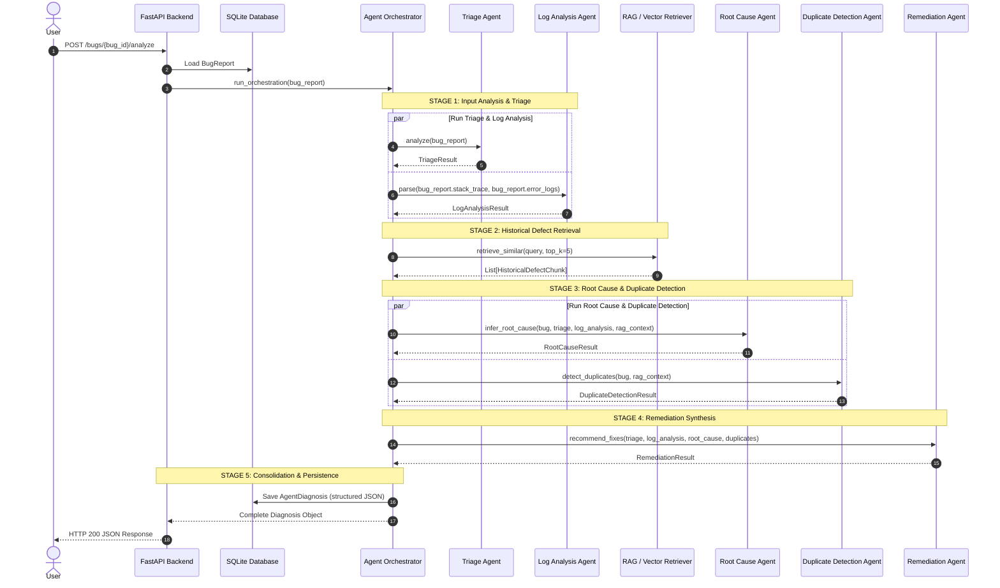

# Agent Orchestration Specification

The multi-agent workflow coordinates five specialized agents across distinct execution stages, ensuring that downstream agents operate on validated, enriched context rather than isolated fragments.

---

## 1. Orchestration Pipeline Flow

---

## 2. Stage Execution Details

### Stage 1: Input Analysis & Parsing
- **Inputs**: Raw bug report (title, description, optional stack trace, error logs, user-supplied component, environment).
- **Execution**:
  - `TriageAgent`: Assesses severity and priority; identifies likely system subsystem.
  - `LogAnalysisAgent`: Parses stack traces, extracts exception class, failure point (`file:line`), and reconstructs call hierarchy.
- **Output Artifacts**: `TriageResult` and `LogAnalysisResult`.

### Stage 2: Semantic RAG Retrieval
- **Query Synthesis**: The orchestrator builds an enriched query vector combining the bug title, failure point from Log Analysis, and core symptoms from Triage.
- **Vector Search**: ChromaDB retrieves the top-5 historical defect chunks from Mozilla, Apache, and Eclipse datasets.
- **Output Artifacts**: Structured collection of retrieved chunks with cosine similarities and resolution summaries.

### Stage 3: Root Cause & Duplicate Reasoning
- **Execution**:
  - `RootCauseAgent`: Synthesizes Stage 1 parser outputs with Stage 2 historical precedents. Generates a grounded hypothesis with citations.
  - `DuplicateDetectionAgent`: Compares similarity metrics against calibrated thresholds (`0.85` duplicate / `0.65` related) to classify issue duplication.
- **Output Artifacts**: `RootCauseResult` and `DuplicateDetectionResult`.

### Stage 4: Remediation Generation
- **Inputs**: All Stage 1, 2, and 3 outputs.
- **Execution**:
  - `RemediationAgent`: Produces targeted code snippets, configuration adjustments, and step-by-step verification procedures.
  - Categorizes evidence foundation: Historical Evidence vs. General Best Practice vs. Agent Recommendation.
- **Output Artifacts**: `RemediationResult`.

### Stage 5: Persistence & Serialization
- All agent outputs are committed atomically to SQLite in the `agent_diagnoses` table.
- Results are accessible via `GET /bugs/{bug_id}/diagnosis` and formatted for the interactive UI.

---

## 3. Resilience & Failure Isolation

1. **Agent Error Handling**: If an individual agent encounters an unexpected exception or formatting error, the orchestrator catches it, logs the trace, and inserts an `"Insufficient Evidence"` fallback state for that specific agent.
2. **Cascading Protection**: Downstream agents check upstream output statuses. If `LogAnalysisAgent` returns `"Insufficient Evidence"`, `RootCauseAgent` shifts focus to textual description heuristics rather than aborting the pipeline.
3. **Deterministic Heuristic Fallback**: If external LLM APIs (Gemini/OpenAI) are unavailable, unreachable, or unconfigured, the system automatically falls back to internal rule-based parsers, ensuring zero pipeline crashes.
