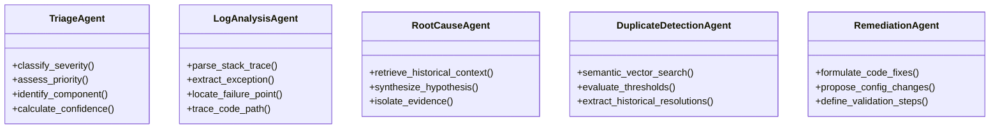

# Agent Responsibilities Specification

The platform orchestrates exactly **five specialized AI agents**, each with dedicated, non-overlapping analytical boundaries and standardized output schemas.



---

## 1. Triage Agent

### Objective
Provide rapid initial classification of the defect to prioritize development queueing and direct the issue to the appropriate subsystem maintainers.

### Core Responsibilities
- **Severity Classification**: Assess system impact (`Critical`, `High`, `Medium`, `Low`).
  - *Critical*: System crash, complete service outage, data corruption, security vulnerability.
  - *High*: Major feature failure with no workaround, severe performance degradation.
  - *Medium*: Non-critical feature broken, workaround available.
  - *Low*: Minor cosmetic flaw, typo, low-impact UI glitch.
- **Priority Assessment**: Urgency of scheduling fix (`Critical`, `High`, `Medium`, `Low`).
- **Affected Component Identification**: Infer architectural subsystem (e.g., `Authentication`, `Database`, `UI/Frontend`, `Network/API`, `File Storage`).
- **Confidence Scoring**: Probability estimate (0.00 to 1.00) reflecting classification certainty.
- **Reasoning**: Natural-language explanation linking input keywords and symptoms to the classification.
- **Boundary**: Does not attempt to diagnose code lines or suggest fixes. Handles sparse descriptions with low confidence warnings.

### Standardized JSON Output Schema
```json
{
  "severity": "High",
  "priority": "High",
  "affected_component": "Authentication",
  "confidence": 0.88,
  "reasoning": "Null pointer exception encountered during user credential verification sequence, blocking login functionality."
}
```

---

## 2. Log Analysis Agent

### Objective
Deconstruct unstructured runtime logs and stack traces into structured, machine-parsable execution frames.

### Core Responsibilities
- **Exception Type Extraction**: Identify technical exception or error class (e.g., `java.lang.NullPointerException`, `KeyError`, `psycopg2.OperationalError`).
- **Error Message Parsing**: Extract the root error message string.
- **Failure Point Pinpointing**: Identify the exact source file, line number, and class/function where the exception was triggered (e.g., `LoginService.java:42`).
- **Affected Code Path Reconstruction**: Map call stack progression leading to failure (e.g., `AuthController.login -> UserService.authenticate -> TokenProvider.generate`).
- **Confidence Scoring**: Degree of trace clarity and format validity (0.00 to 1.00).
- **Graceful Handling of Missing Logs**: Returns `"status": "Insufficient Evidence"` when no stack trace or error log is provided, without crashing.

### Standardized JSON Output Schema
```json
{
  "status": "Success",
  "exception_type": "NullPointerException",
  "error_message": "Cannot invoke String.toLowerCase() because username is null",
  "failure_point": "AuthService.java:38",
  "affected_code_path": "AuthController.handleLogin -> AuthService.validateCredentials",
  "confidence": 0.94
}
```

---

## 3. Root Cause Agent

### Objective
Infer the underlying causal mechanism behind the defect by synthesizing Stage 1 agent outputs with RAG-retrieved historical defect precedents.

### Core Responsibilities
- **Hypothesis Formulation**: Formulate a grounded hypothesis explaining *why* the failure occurred.
- **Strict Evidence Separation**: Distinctly separate:
  1. **Retrieved Historical Evidence**: Empirically documented past defects from Mozilla/Apache/Eclipse.
  2. **Agent Reasoning**: Inductive deductions bridging the historical evidence and user symptoms.
  3. **Root Cause Hypothesis**: The resulting diagnostic statement.
- **Honest Evidence Evaluation**: Explicitly marks `"status": "Insufficient Evidence"` if symptoms do not sufficiently correlate with known patterns.

### Standardized JSON Output Schema
```json
{
  "status": "Supported",
  "root_cause_hypothesis": "Unvalidated null payload passed into token serializer due to missing defensive boundary check during session handshake.",
  "confidence": 0.82,
  "supporting_evidence": [
    {
      "bug_id": "APACHE-SPARK-14920",
      "source": "Apache",
      "similarity": 0.89,
      "evidence": "NullPointerException when client initiates handshake without credentials header; resolved by adding explicit null guard in AuthManager."
    }
  ],
  "reasoning": "The observed call stack in AuthService.java:38 matches APACHE-SPARK-14920 where null input was allowed into string transformation methods without prior validation."
}
```

---

## 4. Duplicate Detection Agent

### Objective
Quantify semantic similarity between the new defect and historical bug repositories (Mozilla, Apache, Eclipse) and previously submitted platform issues.

### Core Responsibilities
- **Semantic Vector Comparison**: Compute cosine similarities across the vector space.
- **Empirical Threshold Categorization**:
  - `Similarity >= 0.85`: **Likely Duplicate**
  - `0.65 <= Similarity < 0.85`: **Related Issue**
  - `Similarity < 0.65`: **New / Unmatched**
  - Text length < 15 chars: **Insufficient Evidence**
- **Resolution Summary Extraction**: Extract verified resolution summaries and fix commit references from matching records.

### Standardized JSON Output Schema
```json
{
  "status": "Likely Duplicate",
  "matches": [
    {
      "bug_id": "MOZILLA-118492",
      "similarity": 0.88,
      "title": "NPE in SessionManager when token contains null claim",
      "source": "Mozilla",
      "component": "Authentication",
      "resolution_summary": "Fixed by adding Objects.requireNonNull check before claim parsing in bug patch #492."
    }
  ],
  "reasoning": "Found 1 defect exceeding the 0.85 similarity threshold with matching exception type and failure call flow."
}
```

---

## 5. Remediation Agent

### Objective
Deliver concrete, actionable, and testable engineering remedies to fix the defect and prevent regression.

### Core Responsibilities
- **Concrete Fix Recommendations**: Provide specific code modifications, boundary checks, or configuration tuning.
- **Classification of Remediation Basis**:
  - `Historical Evidence`: Direct adaptation of a verified patch from a matching historical defect.
  - `General Best Practice`: Standard defensive programming idiom (e.g., null safety, connection pooling).
  - `Agent Recommendation`: Derived contextual solution.
- **Validation Procedures**: Concrete unit test cases and verification steps to prove fix efficacy.
- **Refusal to Speculate**: Displays `"Insufficient Evidence"` when inputs lack diagnostic specifics.

### Standardized JSON Output Schema
```json
{
  "status": "Supported",
  "recommendations": [
    {
      "recommendation": "Add defensive null verification before calling String methods in AuthService.java",
      "confidence": 0.87,
      "basis": "Historical Evidence",
      "affected_module": "AuthService.java:38",
      "suggested_code": "if (username == null || username.trim().isEmpty()) {\n    throw new InvalidCredentialsException(\"Username cannot be null or empty\");\n}",
      "supporting_bug_ids": ["APACHE-SPARK-14920"],
      "validation_steps": [
        "1. Write unit test submitting null username payload and verify InvalidCredentialsException is thrown.",
        "2. Run regression suite for authentication flow.",
        "3. Verify that server no longer crashes with unhandled 500 NullPointerException."
      ]
    }
  ]
}
```
