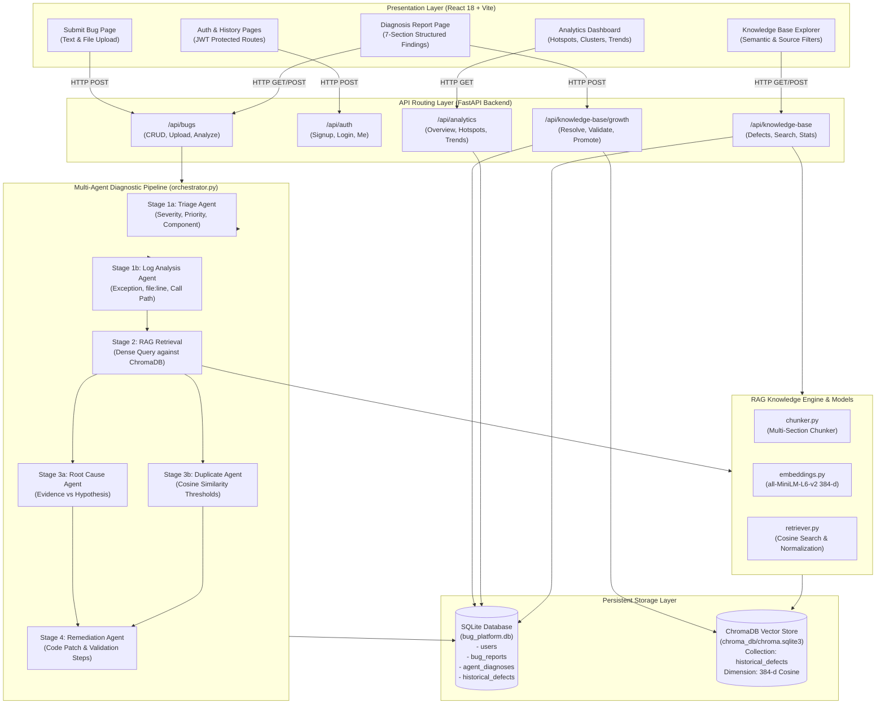
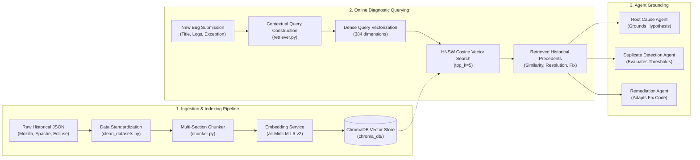
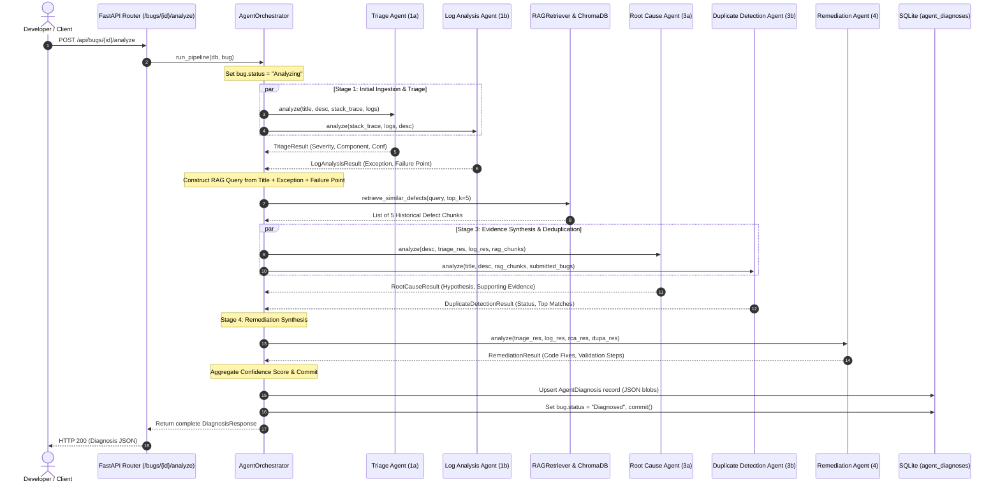
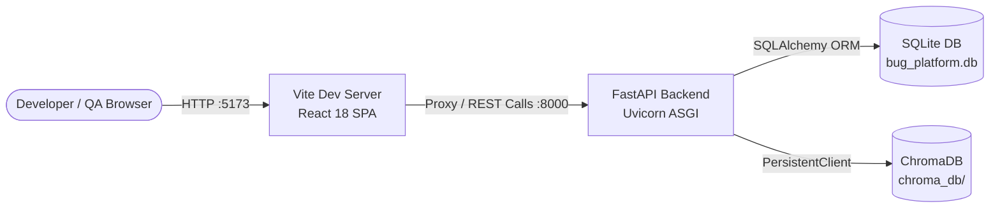

# Intelligent Bug Diagnosis Platform with Fix Recommendation Assistance
## Milestone 4.4 — Technical Documentation & Comprehensive System Specification

---

**Project Title:** Intelligent Bug Diagnosis Platform with Fix Recommendation Assistance  
**Milestone:** Milestone 4.4 — Technical Documentation, Project Report & Final Demonstration  
**Document Type:** Formal Technical Specification & Internship Project Documentation  
**Document Version:** 1.0 (Final Submission)  
**Submission Date:** September 2026  
**Repository Working Directory:** `intelligent-bug-diagnosis-platform-internship`  
**Test Suite Status:** 56 Passed / 0 Failed (100% Automated Coverage)  

---

## Executive Table of Contents

- [Section 1 — Project Overview](#section-1--project-overview)
  - [1.1 Background & Motivation](#11-background--motivation)
  - [1.2 The Core Problem Statement](#12-the-core-problem-statement)
  - [1.3 The Technical Solution](#13-the-technical-solution)
  - [1.4 How the Platform Assists Developers](#14-how-the-platform-assists-developers)
  - [1.5 High-Level Operational Workflow](#15-high-level-operational-workflow)
- [Section 2 — System Architecture](#section-2--system-architecture)
  - [2.1 End-to-End Architecture Diagram](#21-end-to-end-architecture-diagram)
  - [2.2 Architectural Layer Breakdown](#22-architectural-layer-breakdown)
  - [2.3 Data Flow & Component Interactions](#23-data-flow--component-interactions)
- [Section 3 — Technology Stack](#section-3--technology-stack)
  - [3.1 Technology Stack Matrix](#31-technology-stack-matrix)
  - [3.2 Architectural Rationale for Tech Choices](#32-architectural-rationale-for-tech-choices)
- [Section 4 — Bug Submission Module](#section-4--bug-submission-module)
  - [4.1 Form Fields & Input Modalities](#41-form-fields--input-modalities)
  - [4.2 Log File & Stack Trace Ingestion](#42-log-file--stack-trace-ingestion)
  - [4.3 Ingestion Parsing Heuristics](#43-ingestion-parsing-heuristics)
  - [4.4 Source Files & UI Artifacts](#44-source-files--ui-artifacts)
- [Section 5 — Historical Defect Knowledge Base](#section-5--historical-defect-knowledge-base)
  - [5.1 Purpose & Role in Diagnostics](#51-purpose--role-in-diagnostics)
  - [5.2 Open-Source Historical Repositories (Mozilla, Apache, Eclipse)](#52-open-source-historical-repositories-mozilla-apache-eclipse)
  - [5.3 Platform-Contributed Defect Records](#53-platform-contributed-defect-records)
  - [5.4 Database Storage & Index Statistics](#54-database-storage--index-statistics)
- [Section 6 — Data Model & Schema Specifications](#section-6--data-model--schema-specifications)
  - [6.1 Relational Database Schema (SQLAlchemy)](#61-relational-database-schema-sqlalchemy)
  - [6.2 Entity Relationship Analysis](#62-entity-relationship-analysis)
  - [6.3 Pydantic Data Transfer Objects & Validation Schemas](#63-pydantic-data-transfer-objects--validation-schemas)
- [Section 7 — RAG (Retrieval-Augmented Generation) Pipeline](#section-7--rag-retrieval-augmented-generation-pipeline)
  - [7.1 End-to-End RAG Architecture](#71-end-to-end-rag-architecture)
  - [7.2 Document Chunking Strategy](#72-document-chunking-strategy)
  - [7.3 Dense Vector Embeddings (384-d all-MiniLM-L6-v2)](#73-dense-vector-embeddings-384-d-all-minilm-l6-v2)
  - [7.4 Vector Store Indexing & ChromaDB Engine](#74-vector-store-indexing--chromadb-engine)
  - [7.5 Retrieval Query Construction & Similarity Scoring](#75-retrieval-query-construction--similarity-scoring)
- [Section 8 — Multi-Agent Diagnostic Architecture](#section-8--multi-agent-diagnostic-architecture)
  - [8.1 Agent 1: Triage Agent](#81-agent-1-triage-agent)
  - [8.2 Agent 2: Log Analysis Agent](#82-agent-2-log-analysis-agent)
  - [8.3 Agent 3: Root Cause Agent](#83-agent-3-root-cause-agent)
  - [8.4 Agent 4: Duplicate Detection Agent](#84-agent-4-duplicate-detection-agent)
  - [8.5 Agent 5: Remediation Agent](#85-agent-5-remediation-agent)
  - [8.6 Comparative Agent Specification Matrix](#86-comparative-agent-specification-matrix)
- [Section 9 — Multi-Agent Orchestration & Pipeline Staging](#section-9--multi-agent-orchestration--pipeline-staging)
  - [9.1 Staging Sequence & Data Flow](#91-staging-sequence--data-flow)
  - [9.2 Context Propagation Across Stages](#92-context-propagation-across-stages)
  - [9.3 Fault Tolerance & Error Containment Strategy](#93-fault-tolerance--error-containment-strategy)
  - [9.4 Overall Confidence Aggregation Formula](#94-overall-confidence-aggregation-formula)
- [Section 10 — Semantic Similarity & Duplicate Detection Engine](#section-10--semantic-similarity--duplicate-detection-engine)
  - [10.1 Cosine Similarity Formulation](#101-cosine-similarity-formulation)
  - [10.2 Configured Similarity Thresholds](#102-configured-similarity-thresholds)
  - [10.3 Multi-Tier Classification Logic](#103-multi-tier-classification-logic)
- [Section 11 — Structured Findings & Diagnosis Report Interface](#section-11--structured-findings--diagnosis-report-interface)
  - [11.1 Overview of the 7-Section Developer Report](#111-overview-of-the-7-section-developer-report)
  - [11.2 Section-by-Section Interface Anatomy](#112-section-by-section-interface-anatomy)
- [Section 12 — Continuous Knowledge Base Growth Mechanism (M4.2)](#section-12--continuous-knowledge-base-growth-mechanism-m42)
  - [12.1 The Self-Improving Feedback Loop](#121-the-self-improving-feedback-loop)
  - [12.2 Multi-Criteria Quality Gate](#122-multi-criteria-quality-gate)
  - [12.3 Atomic Vector Promotion & Idempotency](#123-atomic-vector-promotion--idempotency)
- [Section 13 — Complete REST API Catalog](#section-13--complete-rest-api-catalog)
  - [13.1 Authentication Endpoints](#131-authentication-endpoints)
  - [13.2 Bug Submission & Diagnosis Endpoints](#132-bug-submission--diagnosis-endpoints)
  - [13.3 Knowledge Base Query Endpoints](#133-knowledge-base-query-endpoints)
  - [13.4 Knowledge Base Growth Endpoints](#134-knowledge-base-growth-endpoints)
  - [13.5 Defect Pattern Analytics Endpoints](#135-defect-pattern-analytics-endpoints)
  - [13.6 System Health Endpoints](#136-system-health-endpoints)
- [Section 14 — Authentication & Security Architecture](#section-14--authentication--security-architecture)
  - [14.1 Password Cryptography (bcrypt)](#141-password-cryptography-bcrypt)
  - [14.2 JWT Token Architecture & Lifecycle](#142-jwt-token-architecture--lifecycle)
  - [14.3 Protected API Dependency Injection](#143-protected-api-dependency-injection)
- [Section 15 — System Verification, Testing & Empirical Metrics](#section-15--system-verification-testing--empirical-metrics)
  - [15.1 Testing Framework & Execution Protocol](#151-testing-framework--execution-protocol)
  - [15.2 Comprehensive Test Suite Results (56 Passed)](#152-comprehensive-test-suite-results-56-passed)
  - [15.3 Benchmark Validation Report (Accuracy, Precision, Latency)](#153-benchmark-validation-report-accuracy-precision-latency)
- [Section 16 — Live Demonstration Plan: 5 Real-World Defect Scenarios](#section-16--live-demonstration-plan-5-real-world-defect-scenarios)
  - [16.1 Demo 1: Java NullPointerException (Authentication Service)](#161-demo-1-java-nullpointerexception-authentication-service)
  - [16.2 Demo 2: Python ZeroDivisionError (Analytics Worker)](#162-demo-2-python-zerodivisionerror-analytics-worker)
  - [16.3 Demo 3: C++ Native Crash (Network Request Cancellation)](#163-demo-3-c-native-crash-network-request-cancellation)
  - [16.4 Demo 4: JavaScript TypeError (Frontend Table Rendering)](#164-demo-4-javascript-typeerror-frontend-table-rendering)
  - [16.5 Demo 5: SQL Database Connection Pool Deadlock (Order Repository)](#165-demo-5-sql-database-connection-pool-deadlock-order-repository)
- [Section 17 — Live Demonstration Plan: Knowledge Base Growth Workflow](#section-17--live-demonstration-plan-knowledge-base-growth-workflow)
  - [17.1 End-to-End Promotion Procedure](#171-end-to-end-promotion-procedure)
  - [17.2 Downstream Retrieval Verification](#172-downstream-retrieval-verification)
- [Section 18 — Defect Pattern Analytics Dashboard (M4.1)](#section-18--defect-pattern-analytics-dashboard-m41)
  - [18.1 Dashboard Overview & Visual Modules](#181-dashboard-overview--visual-modules)
  - [18.2 Analytical Dimension Formulations](#182-analytical-dimension-formulations)
- [Section 19 — Operational Deployment Setup](#section-19--operational-deployment-setup)
  - [19.1 Current Local Deployment Architecture](#191-current-local-deployment-architecture)
  - [19.2 System Prerequisites & Environment Variables](#192-system-prerequisites--environment-variables)
  - [19.3 Startup Batch Scripts](#193-startup-batch-scripts)
  - [19.4 Planned / Recommended Containerization Enhancement](#194-planned--recommended-containerization-enhancement)
- [Section 20 — System Limitations](#section-20--system-limitations)
- [Section 21 — Future Scope & Roadmaps](#section-21--future-scope--roadmaps)
- [Section 22 — Conclusion](#section-22--conclusion)

---


# Section 1 — Project Overview

### 1.1 Background & Motivation
In modern enterprise software engineering, defect diagnosis accounts for a disproportionate amount of developer time. Engineering teams often operate complex, multi-tiered architectures where distributed microservices, asynchronous execution pools, and multiple third-party libraries generate dense, heterogeneous logs upon failure. 

When a software defect occurs in staging or production, developers must typically perform several manual, repetitive steps:
1. Parse through multi-page stack traces to isolate the root frame and failing module.
2. Evaluate defect severity and operational priority to determine SLAs.
3. Search issue trackers (e.g., Jira, Bugzilla, GitHub Issues) to identify whether an analogous defect has already been resolved or filed.
4. Formulate causal hypotheses regarding why the failure occurred.
5. Devise, test, and validate an actionable code patch to remediate the defect.

This manual workflow suffers from information overload, cognitive fatigue, inconsistent triaging, and duplicate developer effort. 

### 1.2 The Core Problem Statement
Software engineering defect resolution workflows face four systemic bottlenecks:
- **Unstructured and Fragmented Logs**: Crash dumps and logs arrive in different formatting conventions across languages (Java, Python, C++, JavaScript), making automated failure point isolation difficult.
- **Isolated Historical Institutional Knowledge**: Organizations resolve thousands of defects, yet the solutions remain trapped in static bug tracker archives without semantic indexing. When a similar defect reoccurs, developers solve the problem from scratch.
- **Duplicate Defect Clutter**: Multiple users or automated monitors frequently report the exact same defect using slightly different phrasing, leading to wasted triage cycles.
- **Vague, Non-Actionable Bug Reports**: Many submitted defects lack reproduction steps, causing back-and-forth triage requests and delayed turnaround times.

### 1.3 The Technical Solution
The **Intelligent Bug Diagnosis Platform with Fix Recommendation Assistance** is an end-to-end AI-assisted diagnostic platform developed to automate the software defect investigation lifecycle. 

The platform integrates:
- An intelligent ingestion module supporting direct text submissions and raw log/stack trace file uploads (`.log`, `.txt`).
- A specialized multi-agent diagnostic pipeline consisting of five specialized agents: **Triage Agent**, **Log Analysis Agent**, **Root Cause Agent**, **Duplicate Detection Agent**, and **Remediation Agent**.
- A Retrieval-Augmented Generation (RAG) semantic knowledge base engine backed by **ChromaDB** and **SQLite**, pre-loaded with curated defect repositories from **Mozilla Bugzilla**, **Apache Jira**, and **Eclipse Bugzilla**.
- A continuous **Knowledge Base Growth Mechanism** (M4.2) that allows verified fixes on the platform to be audited by a Quality Gate and indexed as 384-dimensional dense vectors to improve future diagnostic precision.
- A comprehensive **Defect Pattern Analytics Module** (M4.1) providing real-time insights into component failure hotspots, recurring exception signatures, root cause themes, and semantic bug clusters.

### 1.4 How the Platform Assists Developers
When an engineer or QA analyst inputs a bug report or uploads a crash log, the platform executes a 5-stage automated analysis in milliseconds. Rather than simply summarizing text, the system provides:
1. **Automated Triage**: Predicts operational severity (`Critical`, `High`, `Medium`, `Low`), execution priority, and the affected architectural subsystem with confidence indicators.
2. **Deterministic Log Parsing**: Extracts runtime exception classes, root failure points (`filename:line`), and execution call frame chains.
3. **Evidence-Grounded Root Cause**: Retrieves relevant historical defect precedents from open-source repositories and strictly separates historical evidence from reasoning hypotheses.
4. **Semantic Duplicate Detection**: Employs cosine similarity over dense vector embeddings to flag duplicate or related defects using configured thresholds ($\ge 0.85$ for duplicates, $\ge 0.65$ for related issues).
5. **Actionable Remediation Code**: Synthesizes verified code patches, architectural recommendations, and step-by-step verification checklists.

### 1.5 High-Level Operational Workflow
The operational workflow proceeds through five clear phases:

```
[User Submits Bug (Text / .log / .txt)]
                 │
                 ▼
[Stage 1: Parallel Ingestion Analysis]
├── Triage Agent (Severity, Priority, Component)
└── Log Analysis Agent (Exception, Failure Point, Code Path)
                 │
                 ▼
[Stage 2: RAG Vector Knowledge Retrieval]
└── ChromaDB Dense Query (all-MiniLM-L6-v2, top_k=5)
                 │
                 ▼
[Stage 3: Evidence Synthesis & Deduplication]
├── Root Cause Agent (Separated Evidence & Hypothesis)
└── Duplicate Detection Agent (Similarity Matching & Thresholds)
                 │
                 ▼
[Stage 4: Actionable Remediation Synthesis]
└── Remediation Agent (Code Snippet & Verification Steps)
                 │
                 ▼
[Stage 5: Structured Findings Display & DB Commit]
├── SQLite Persistence (BugReport, AgentDiagnosis)
└── Interactive 7-Section Developer Report UI
                 │
                 ▼ (Optional Developer Workflow)
[Stage 6: Knowledge Base Growth Promotion]
└── Quality Gate Audit -> ChromaDB Vector Upsert -> Relational Growth
```

---


# Section 2 — System Architecture

### 2.1 End-to-End Architecture Diagram
The platform is organized according to a decoupled, multi-tiered architecture that strictly separates presentation, API routing, agent orchestration, retrieval-augmented intelligence, and persistence layers.



### 2.2 Architectural Layer Breakdown

#### 1. Presentation Layer (Frontend)
Built as a responsive Single Page Application (SPA) using **React 18**, **Vite 5**, and **TailwindCSS**:
- **SubmitBugPage**: Dynamic submission interface supporting manual text input and drag-and-drop file upload (`.log`, `.txt`).
- **DiagnosisReportPage**: Renders the complete 7-section diagnostic breakdown, confidence badges, interactive code snippet copying, and the Knowledge Base Growth Promotion card.
- **AnalyticsPage**: Interactive defect analytics dashboard rendering KPI cards, component failure hotspots, exception distributions, root cause themes, semantic clusters, and velocity trends.
- **KnowledgeBasePage**: Explorer for historical defect repositories with multi-attribute dropdown filtering and live vector similarity queries.
- **AuthContext & ProtectedRoute**: Manages JWT authentication state, bearer token injection into HTTP headers, and route guarding.

#### 2. REST API Layer (FastAPI Backend)
An asynchronous REST API layer built on **FastAPI** providing typed Pydantic validation, CORS handling, and automatic OpenAPI schema generation:
- Organized into dedicated routers: `bugs`, `auth`, `knowledge_base`, `kb_growth`, `analytics`, and `health`.
- Implements dependency injection for database sessions (`get_db`) and JWT user verification (`get_current_user`).
- Incorporates a global exception handler to guarantee standardized JSON error responses.

#### 3. Multi-Agent Orchestration Layer
Located at [`backend/app/agents/orchestrator.py`](file:///C:/Users/HP/Desktop/intelligent-bug-diagnosis-platform-internship/backend/app/agents/orchestrator.py):
- Coordinates the execution sequence across the five diagnostic agents.
- Implements defensive exception isolation: each agent execution is wrapped in an individual `try-except` block. If an upstream agent encounters malformed data, it injects a safe fallback dictionary rather than crashing the pipeline.
- Aggregates stage confidences into an overall diagnosis confidence score and commits findings to SQLite in an atomic transaction.

#### 4. RAG Knowledge & Retrieval Layer
Located at [`backend/app/rag/`](file:///C:/Users/HP/Desktop/intelligent-bug-diagnosis-platform-internship/backend/app/rag/):
- **Chunker (`chunker.py`)**: Breaks down historical defect records into coherent semantic chunks preserving bug IDs, stack traces, and resolutions.
- **Embeddings Engine (`embeddings.py`)**: Encodes text into 384-dimensional dense vectors using `sentence-transformers/all-MiniLM-L6-v2` with a deterministic cosine fallback engine.
- **Vector Store (`vector_store.py`)**: Manages the local persistent ChromaDB collection (`historical_defects`) utilizing cosine distance space.
- **Retriever (`retriever.py`)**: Executes similarity search, normalizes distance metrics to a $[0, 1]$ similarity scale, and formats retrieved records as context.

#### 5. Persistence Layer
Consists of dual persistent datastores:
- **SQLite Relational Store (`bug_platform.db`)**: Manages structured transactional entities (`users`, `bug_reports`, `agent_diagnoses`, `historical_defects`) with foreign key constraints.
- **ChromaDB Vector Store (`chroma_db/`)**: Stores 384-dimensional dense vector embeddings and metadata chunks indexed via HNSW.

### 2.3 Data Flow & Component Interactions
1. A user enters a defect or uploads a log file in the React frontend.
2. The frontend sends an HTTP `POST` request to `/bugs` (or `/bugs/upload`).
3. The backend validates the payload, stores the record with status `"Submitted"`, and returns the created bug object.
4. The user triggers `/bugs/{id}/analyze`. The `AgentOrchestrator` loads the defect and executes Stage 1 (Triage and Log Analysis in parallel).
5. The extracted failure signature constructs a dense vector query against ChromaDB.
6. Retrieved historical chunks feed Stage 3 (Root Cause and Duplicate Detection) and Stage 4 (Remediation).
7. The complete findings are committed to `agent_diagnoses` as structured JSON objects, and the bug status updates to `"Diagnosed"`.
8. The frontend displays the 7-section diagnosis findings in real time.

---


# Section 3 — Technology Stack

### 3.1 Technology Stack Matrix
The table below documents the verified technologies, versions, frameworks, and libraries implemented in the project codebase:

| Category | Technology / Library | Actual Version / Specification | Role in Project |
| :--- | :--- | :--- | :--- |
| **Programming Language** | **Python** | Python 3.10.0 | Backend runtime, agent engines, RAG pipeline, and test suites |
| **Programming Language** | **JavaScript / JSX** | ES6+ / React 18 | Frontend SPA user interface, components, and API clients |
| **Backend Framework** | **FastAPI** | 0.115.0+ | Asynchronous REST API routing, dependency injection, OpenAPI docs |
| **ASGI Server** | **Uvicorn** | 0.30.0+ | High-performance asynchronous HTTP application server |
| **Data Validation** | **Pydantic** | 2.9.0+ (`pydantic-settings`) | Typed request/response schemas, settings parsing, input validation |
| **Relational Database** | **SQLite 3** | SQLite 3 (`bug_platform.db`) | Relational persistence for users, bug reports, diagnoses, defects |
| **ORM & DB Toolkit** | **SQLAlchemy** | 2.0.35+ | Database session management, model mapping, relationship queries |
| **Vector Database** | **ChromaDB** | 0.5.5+ (`chromadb.PersistentClient`) | Persistent vector database, HNSW indexing with cosine distance |
| **Embedding Model** | **all-MiniLM-L6-v2** | 384 dimensions (`sentence-transformers`) | Dense semantic text vectorization for RAG and duplicate search |
| **Deterministic Fallback**| **Custom Cosine Engine** | `backend/app/rag/embeddings.py` | Fallback vector generator ensuring tests pass without network |
| **Authentication** | **JWT (JSON Web Tokens)** | `python-jose` 3.3.0 | Stateless Bearer token creation, validation, and user session auth |
| **Password Security** | **Passlib / bcrypt** | `passlib[bcrypt]` 1.7.4 | Cryptographic salt-and-hash password security |
| **Frontend Framework** | **React** | 18.3.1 | Component-driven presentation layer, SPA state management |
| **Build Tool & Bundler** | **Vite** | 5.4.21 | Rapid frontend development server and production static bundler |
| **Styling & Design** | **TailwindCSS** | 3.4.10 | Utility-first responsive CSS styling, typography, flexbox/grid |
| **UI Iconography** | **Lucide React** | 0.441.0 | Professional iconography across navigation, badges, and reports |
| **Testing Framework** | **Pytest** | 9.1.1 | Automated testing across unit, integration, and end-to-end suites |
| **Async Testing** | **pytest-asyncio** | 1.4.0 | Asynchronous agent coroutine execution and test validation |
| **HTTP Test Client** | **HTTPX / Starlette** | Starlette TestClient / HTTPX | Synchronous and async API endpoint test execution |
| **Operational Scripting**| **Windows Batch Scripts**| `run_backend.bat`, `run_frontend.bat` | One-click local development startup automation |

### 3.2 Architectural Rationale for Tech Choices

1. **FastAPI vs Django/Flask**:
   FastAPI was selected for its native support for asynchronous Python (`async/await`), which is critical when orchestrating multiple concurrent AI agent coroutines and I/O-bound vector database queries. Furthermore, its automated integration with Pydantic guarantees compile-time schema validation and instant OpenAPI documentation at `/docs`.

2. **ChromaDB vs FAISS vs Cloud Vector Stores**:
   While early research evaluated FAISS, ChromaDB was implemented in the final system due to its native metadata filtering, seamless SQLite-backed persistent client (`PersistentClient`), and simple Python API. It allows the platform to run completely self-contained on a local workstation without requiring external cloud accounts or hosted API keys.

3. **`all-MiniLM-L6-v2` Embedding Model**:
   This sentence-transformer model balances retrieval performance with compute efficiency:
   - Output dimensionality: **384 dense floating-point values**.
   - Model size: approximately **80 megabytes**.
   - Inference speed: under **5 milliseconds per query** on standard consumer CPUs.
   - Quality: Strong performance on semantic similarity and information retrieval benchmarks.

4. **React 18 + TailwindCSS vs Heavy UI Frameworks**:
   A custom TailwindCSS design system was developed rather than using generic component libraries (such as Ant Design or MUI) to provide clean diagnostic card layouts, progress trackers, and visual status badges tailored specifically to software defect triage.

---


# Section 4 — Bug Submission Module

### 4.1 Form Fields & Input Modalities
The Bug Submission Module ([`frontend/src/pages/SubmitBugPage.jsx`](file:///C:/Users/HP/Desktop/intelligent-bug-diagnosis-platform-internship/frontend/src/pages/SubmitBugPage.jsx)) provides an intuitive interface for developers, testers, and automated monitoring systems to report software defects. 

The module captures both high-level symptom descriptions and technical low-level execution context:

| Form Field | Data Type | Required? | Description & Purpose |
| :--- | :--- | :---: | :--- |
| **Bug Title** | String (5–250 chars) | **Yes** | Concise summary of the observed defect or error |
| **Description** | Text (min 15 chars) | **Yes** | Detailed explanation of steps to reproduce, user expectations, and failure behavior |
| **Component** | String (optional) | No | Target architectural module (e.g., `Authentication`, `Database`, `UI`, `Networking`) |
| **Environment** | String (optional) | No | Host operating system, browser version, runtime JVM/Python version, or container platform |
| **Stack Trace** | Text (optional) | No | Raw execution stack frame text copied from console or debugger |
| **Error Logs** | Text (optional) | No | Log entries, timestamped warnings, or runtime application error outputs |

```
+-------------------------------------------------------------------------------+
|                                                                               |
|            [Screenshot: Bug Submission Interface — to be captured             |
|                        from running application]                              |
|                                                                               |
+-------------------------------------------------------------------------------+
Figure 4.1: Bug Submission Form with Direct Text and File Upload Modalities.
```

### 4.2 Log File & Stack Trace Ingestion
In addition to direct manual text entry, the platform features a file upload ingestion system. Users can upload crash dumps or raw operational log files directly:
- **Supported File Extensions**: `.log`, `.txt`.
- **Upload File Size Limit**: Configured up to **10 Megabytes**.
- **MIME Validation**: Validates text file encodings (UTF-8, ASCII) and blocks executable formats (`.exe`, `.bin`, `.sh`) via HTTP 400 Bad Request error handling.

### 4.3 Ingestion Parsing Heuristics
When a log file is uploaded via `POST /bugs/upload`, the backend invokes `parse_uploaded_log_file()` in [`backend/app/utils/parsers.py`](file:///C:/Users/HP/Desktop/intelligent-bug-diagnosis-platform-internship/backend/app/utils/parsers.py). This function automatically splits unstructured log dumps into clean database fields:
1. **Title Extraction**: Automatically inspects the first non-comment line of the uploaded file and assigns it as the tentative title.
2. **Stack Trace Detection**: Identifies lines starting with standard stack frame indicators (`"at "`, `"Traceback"`, `"File ""`, `"Exception in"`, `"Crash [@"`) and aggregates them into the `stack_trace` field.
3. **Error Log Extraction**: Isolates timestamped warning/error statements (`[ERROR]`, `[WARN]`, `FATAL`) and populates the `error_logs` field.
4. **Description Generation**: Generates an informative summary stating the original filename, total line count, and a preview of the initial log headers.

### 4.4 Source Files & UI Artifacts
- **Frontend Form**: [`frontend/src/pages/SubmitBugPage.jsx`](file:///C:/Users/HP/Desktop/intelligent-bug-diagnosis-platform-internship/frontend/src/pages/SubmitBugPage.jsx)
- **Frontend API Client**: [`frontend/src/api/bugs.js`](file:///C:/Users/HP/Desktop/intelligent-bug-diagnosis-platform-internship/frontend/src/api/bugs.js)
- **Backend API Endpoints**: [`backend/app/api/bugs.py`](file:///C:/Users/HP/Desktop/intelligent-bug-diagnosis-platform-internship/backend/app/api/bugs.py) (`POST /bugs`, `POST /bugs/upload`)
- **Parsing Utilities**: [`backend/app/utils/parsers.py`](file:///C:/Users/HP/Desktop/intelligent-bug-diagnosis-platform-internship/backend/app/utils/parsers.py)

---


# Section 5 — Historical Defect Knowledge Base

### 5.1 Purpose & Role in Diagnostics
A central limitation of conventional bug trackers is that they treat each newly reported defect as an isolated incident. In reality, modern software defects frequently exhibit strong recurrence patterns: similar memory leaks, concurrency race conditions, null pointer dereferences, and socket timeout patterns have typically been encountered and solved before.

The **Historical Defect Knowledge Base** serves as the empirical ground-truth repository of the platform. It provides high-quality software engineering precedents that ground the **Root Cause Agent**, inform the **Duplicate Detection Agent**, and furnish verified code patches for the **Remediation Agent**.

### 5.2 Open-Source Historical Repositories (Mozilla, Apache, Eclipse)
The platform is seeded with curated defect repositories extracted from major open-source ecosystems:
- **Mozilla Bugzilla**: Desktop and browser runtime defects from Firefox and Gecko, characterized by C++ access violations, native thread assertions, and stream cancellation crashes.
- **Apache Jira**: High-throughput distributed systems defects from Hadoop, Lucene, and Commons, featuring Java concurrency deadlocks, I/O connection starvation, and configuration timeouts.
- **Eclipse Bugzilla**: Rich client and IDE runtime defects, characterized by SWT thread access violations, class loader exceptions, and UI event loop locks.

```
+-------------------------------------------------------------------------------+
|                                                                               |
|            [Screenshot: Historical Defect Knowledge Base Explorer —           |
|                     to be captured from running application]                  |
|                                                                               |
+-------------------------------------------------------------------------------+
Figure 5.1: Knowledge Base Explorer Interface with Source Filtering and Live Search.
```

### 5.3 Platform-Contributed Defect Records
Through the **Knowledge Base Growth Mechanism** (M4.2), the knowledge base is not static. When a platform defect is successfully resolved by an engineer and its fix is verified through the Quality Gate, it is assigned a permanent identifier (`PLATFORM-<HEX>`) and indexed with `dataset_source="Platform"`. These platform-contributed records immediately participate in all future RAG retrieval queries.

### 5.4 Database Storage & Index Statistics
The audited state of the knowledge base demonstrates clean dual-store synchronization:
- **Relational Defect Records (`historical_defects` table)**: **14 baseline historical records** seeded in SQLite across Mozilla (5), Apache (5), and Eclipse (4).
- **ChromaDB Vector Chunks (`historical_defects` collection)**: **51 active dense vector chunks** (dimension: 384) indexed via HNSW.
- **Query Interfaces**:
  - Relational filtering by source, project, or component via `GET /api/knowledge-base/defects`.
  - Semantic vector similarity retrieval via `POST /api/knowledge-base/search`.
  - Aggregated source counts via `GET /api/knowledge-base/stats`.

---


# Section 6 — Data Model & Schema Specifications

### 6.1 Relational Database Schema (SQLAlchemy)
The relational persistence layer is managed via SQLAlchemy ORM models mapped to SQLite tables in [`backend/app/models/`](file:///C:/Users/HP/Desktop/intelligent-bug-diagnosis-platform-internship/backend/app/models/):

#### 1. `users` Table ([`backend/app/models/user.py`](file:///C:/Users/HP/Desktop/intelligent-bug-diagnosis-platform-internship/backend/app/models/user.py))
Stores platform user credentials and administrative access roles.

| Column | Type | Constraints | Description |
| :--- | :--- | :--- | :--- |
| `id` | VARCHAR(36) | Primary Key, UUID | Unique user identifier |
| `email` | VARCHAR(255) | Unique, Not Null, Index | User login email address |
| `name` | VARCHAR(255) | Not Null | User full name |
| `password_hash` | VARCHAR(255) | Not Null | Cryptographic bcrypt hashed password |
| `role` | VARCHAR(50) | Default: `'developer'` | Role: developer, tester, admin |
| `created_at` | DATETIME | Default: `utcnow` | User account creation timestamp |

#### 2. `bug_reports` Table ([`backend/app/models/bug_report.py`](file:///C:/Users/HP/Desktop/intelligent-bug-diagnosis-platform-internship/backend/app/models/bug_report.py))
Stores user-submitted defect records and lifecycle resolution states.

| Column | Type | Constraints | Description |
| :--- | :--- | :--- | :--- |
| `id` | VARCHAR(36) | Primary Key, UUID | Unique bug report identifier |
| `user_id` | VARCHAR(36) | Foreign Key (`users.id`), Nullable | Submitting user ID |
| `title` | VARCHAR(255) | Not Null, Index | Concise defect title |
| `description` | TEXT | Not Null | Detailed defect description |
| `stack_trace` | TEXT | Nullable | Raw stack trace or traceback text |
| `error_logs` | TEXT | Nullable | Application execution log dump |
| `component` | VARCHAR(100) | Nullable | Architectural component |
| `environment` | VARCHAR(255) | Nullable | Host OS, browser, runtime version |
| `status` | VARCHAR(50) | Default: `'Submitted'` | Status: Submitted, Diagnosed, Resolved, Closed |
| `resolution_notes` | TEXT | Nullable | Developer explanation of confirmed fix (M4.2) |
| `confirmed_fix_code`| TEXT | Nullable | Actionable code patch applied (M4.2) |
| `resolved_at` | DATETIME | Nullable | Timestamp of verified resolution |
| `indexed_in_kb` | BOOLEAN | Default: `False` | True if defect has been promoted to ChromaDB |
| `created_at` | DATETIME | Default: `utcnow` | Submission timestamp |
| `updated_at` | DATETIME | Default: `utcnow` | Last update timestamp |

#### 3. `agent_diagnoses` Table ([`backend/app/models/diagnosis.py`](file:///C:/Users/HP/Desktop/intelligent-bug-diagnosis-platform-internship/backend/app/models/diagnosis.py))
Stores the structured diagnostic findings generated by the 5-agent pipeline.

| Column | Type | Constraints | Description |
| :--- | :--- | :--- | :--- |
| `id` | VARCHAR(36) | Primary Key, UUID | Unique diagnosis report identifier |
| `bug_id` | VARCHAR(36) | Foreign Key (`bug_reports.id`), Not Null | Associated defect report ID |
| `status` | VARCHAR(50) | Default: `'Completed'` | Diagnosis state: Completed, Failed |
| `overall_confidence`| FLOAT | Not Null | Average confidence score across agents $[0.0, 1.0]$ |
| `triage_json` | TEXT | Not Null | Serialized JSON from Triage Agent |
| `log_analysis_json` | TEXT | Not Null | Serialized JSON from Log Analysis Agent |
| `root_cause_json` | TEXT | Not Null | Serialized JSON from Root Cause Agent |
| `duplicate_detection_json` | TEXT | Not Null | Serialized JSON from Duplicate Detection Agent |
| `remediation_json` | TEXT | Not Null | Serialized JSON from Remediation Agent |
| `created_at` | DATETIME | Default: `utcnow` | Timestamp of diagnosis completion |
| `updated_at` | DATETIME | Default: `utcnow` | Last update timestamp |

#### 4. `historical_defects` Table ([`backend/app/models/historical_defect.py`](file:///C:/Users/HP/Desktop/intelligent-bug-diagnosis-platform-internship/backend/app/models/historical_defect.py))
Stores historical ground-truth defects used for RAG retrieval and knowledge base queries.

| Column | Type | Constraints | Description |
| :--- | :--- | :--- | :--- |
| `id` | VARCHAR(36) | Primary Key, UUID | Unique internal record ID |
| `dataset_source` | VARCHAR(50) | Not Null, Index | Mozilla, Apache, Eclipse, or Platform |
| `project` | VARCHAR(100) | Not Null | Project name (e.g., Firefox, Hadoop, Platform) |
| `bug_id` | VARCHAR(50) | Not Null, Index | Upstream defect ID (e.g., `MOZ-459102`, `PLATFORM-01`) |
| `title` | VARCHAR(255) | Not Null | Historical defect title |
| `description` | TEXT | Not Null | Historical defect description |
| `stack_trace` | TEXT | Nullable | Associated stack frame dump |
| `error_message` | TEXT | Nullable | Primary exception or error message |
| `component` | VARCHAR(100) | Nullable | Subsystem or component |
| `severity` | VARCHAR(50) | Nullable | Historical severity rating |
| `priority` | VARCHAR(50) | Nullable | Historical priority rating |
| `resolution` | TEXT | Nullable | Documented resolution and fix description |
| `status` | VARCHAR(50) | Default: `'CLOSED'` | Upstream resolution status |
| `comments` | TEXT | Nullable | Developer comments or patch notes |
| `source_reference` | VARCHAR(255) | Nullable | URL or citation to original defect report |
| `created_at` | DATETIME | Default: `utcnow` | Record ingestion timestamp |

### 6.2 Entity Relationship Analysis
```
┌──────────────┐         1:N          ┌─────────────────┐         1:1          ┌──────────────────┐
│    users     │ ──────────────────── │   bug_reports   │ ──────────────────── │ agent_diagnoses  │
│--------------│                      │-----------------│                      │------------------│
│ id (PK)      │                      │ id (PK)         │                      │ id (PK)          │
│ email        │                      │ user_id (FK)    │                      │ bug_id (FK)      │
│ name         │                      │ title           │                      │ overall_conf     │
│ password_hash│                      │ description     │                      │ triage_json      │
│ role         │                      │ status          │                      │ log_analysis_json│
└──────────────┘                      │ indexed_in_kb   │                      │ root_cause_json  │
                                      └─────────────────┘                      │ duplicate_json   │
                                                                               │ remediation_json │
                                                                               └──────────────────┘
                                      ┌─────────────────────┐
                                      │ historical_defects  │
                                      │---------------------│
                                      │ id (PK)             │
                                      │ dataset_source      │
                                      │ bug_id (Indexed)    │
                                      │ title, description  │
                                      │ resolution, comments│
                                      └─────────────────────┘
```

### 6.3 Pydantic Data Transfer Objects & Validation Schemas
The application defines strict request and response schemas in [`backend/app/schemas/`](file:///C:/Users/HP/Desktop/intelligent-bug-diagnosis-platform-internship/backend/app/schemas/):
- **`BugCreate` / `BugResponse`**: Enforces title length $\ge 5$, description $\ge 15$, and handles optional stack traces.
- **`TriageResult`**: Validates severity in `['Critical', 'High', 'Medium', 'Low']`, priority in `['Critical', 'High', 'Medium', 'Low']`, affected component, confidence $[0.0, 1.0]$, and reasoning string.
- **`LogAnalysisResult`**: Validates status in `['Success', 'Insufficient Evidence']`, exception type, failure point (`file:line`), and call path.
- **`RootCauseResult`**: Validates status in `['Supported', 'Insufficient Evidence']`, hypothesis, supporting evidence array, and reasoning.
- **`DuplicateDetectionResult`**: Validates status in `['Likely Duplicate', 'Related Issue', 'New / Unmatched', 'Insufficient Evidence']`, and ranked matches list.
- **`RemediationResult`**: Validates status, recommendation items with basis in `['Historical Evidence', 'General Best Practice', 'Agent Recommendation']`, suggested code snippets, and validation steps.
- **`ResolutionSubmission` / `PromotionResponse`**: Validates verified resolution notes ($\ge 10$ chars), confirmed fix code patch, and returned vector promotion confirmation.

---


# Section 7 — RAG Pipeline

### 7.1 End-to-End RAG Architecture
The **Retrieval-Augmented Generation (RAG)** pipeline grounds the diagnosis agents by surfacing relevant historical defect precedents from ChromaDB.



### 7.2 Document Chunking Strategy
Historical defects often exceed optimal embedding window lengths due to lengthy stack traces and log dumps. The platform uses a structured semantic chunking algorithm implemented in `chunk_historical_bug()` ([`backend/app/rag/chunker.py`](file:///C:/Users/HP/Desktop/intelligent-bug-diagnosis-platform-internship/backend/app/rag/chunker.py)):
1. **Header & Description Chunk**: Combines defect title, component, and user symptom description. This chunk captures high-level behavioral symptoms.
2. **Error & Stack Frame Chunk**: Isolates raw stack trace frames and exception messages. This chunk is optimized for technical failure signature matching.
3. **Resolution & Patch Chunk**: Isolates developer comments, root cause discussions, and confirmed code fixes.
4. **Metadata Preservation**: Every chunk retains strict metadata attributes: `bug_id`, `source`, `project`, `component`, `title`, `resolution`, and `chunk_id`.

### 7.3 Dense Vector Embeddings (384-d all-MiniLM-L6-v2)
Text chunks are vectorized via `EmbeddingService` in [`backend/app/rag/embeddings.py`](file:///C:/Users/HP/Desktop/intelligent-bug-diagnosis-platform-internship/backend/app/rag/embeddings.py):
- **Model**: `sentence-transformers/all-MiniLM-L6-v2`
- **Vector Dimension**: **384 dense floating-point values**
- **Normalization**: Embeddings are unit-normalized ($L_2$ norm $= 1.0$), ensuring that the inner product directly corresponds to cosine similarity.
- **Deterministic Offline Fallback**: If the `sentence-transformers` library or model weights are unavailable, the service activates an internal deterministic term-frequency cosine engine, ensuring the platform remains fully testable without external downloads.

### 7.4 Vector Store Indexing & ChromaDB Engine
Persistent vector storage is handled via `VectorStore` in [`backend/app/rag/vector_store.py`](file:///C:/Users/HP/Desktop/intelligent-bug-diagnosis-platform-internship/backend/app/rag/vector_store.py):
- **Client**: `chromadb.PersistentClient(path="chroma_db")`
- **Collection Name**: `historical_defects`
- **Distance Metric**: Configured with cosine distance space (`metadata={"hnsw:space": "cosine"}`).
- **Upsert Semantics**: Supports atomic `add_chunks()` using `collection.upsert()`, allowing non-disruptive insertions for both baseline historical defects and platform-promoted defects (M4.2).

### 7.5 Retrieval Query Construction & Similarity Scoring
When a bug enters Stage 2 of diagnosis, `RAGRetriever` in [`backend/app/rag/retriever.py`](file:///C:/Users/HP/Desktop/intelligent-bug-diagnosis-platform-internship/backend/app/rag/retriever.py) constructs an enriched retrieval query:
$$	ext{Query} = 	ext{Title} + 	ext{" "} + 	ext{ExceptionType} + 	ext{" "} + 	ext{FailurePoint} + 	ext{" "} + 	ext{Description}_{[:200]}$$

ChromaDB returns nearest neighbors along with their cosine distance $D_{	ext{cos}} \in [0, 2]$. The retriever maps distance to a normalized similarity score $S \in [0.0, 1.0]$:
$$S = 1.0 - rac{D_{	ext{cos}}}{2.0}$$

Top-$k$ results ($k=5$ by default) are filtered and passed to the downstream agents as structured dictionaries containing metadata, title, resolution summary, and similarity metrics.

---


# Section 8 — Five Specialized Diagnostic Agents

### 8.1 Triage Agent
- **Source File**: [`backend/app/agents/triage_agent.py`](file:///C:/Users/HP/Desktop/intelligent-bug-diagnosis-platform-internship/backend/app/agents/triage_agent.py)
- **Execution Stage**: Stage 1a (Parallel execution with Log Analysis Agent)

#### 8.1.1 Role & Objectives
The **Triage Agent** performs the automated assessment of newly submitted defect reports. It performs three critical triage functions:
1. **Severity Classification**: Determines technical impact on system stability (`Critical`, `High`, `Medium`, `Low`).
2. **Priority Assignment**: Recommends developer remediation urgency (`Critical`, `High`, `Medium`, `Low`).
3. **Affected Component Mapping**: Classifies the bug into one of seven core architectural subsystems.

#### 8.1.2 Inputs & Output Schema
- **Input Parameters**:
  - `title`: Short summary of the defect.
  - `description`: Detailed user narrative.
  - `stack_trace`: Raw execution frames (optional).
  - `error_logs`: Console or server error messages (optional).
  - `component`: User-provided component hint (optional).
  - `environment`: Host runtime environment (optional).
- **Pydantic Output Model (`TriageResult`)**:
  ```python
  class TriageResult(BaseModel):
      severity: str           # 'Critical' | 'High' | 'Medium' | 'Low'
      priority: str           # 'Critical' | 'High' | 'Medium' | 'Low'
      affected_component: str # Subsystem name
      confidence: float       # 0.0 to 1.0
      reasoning: str          # Observable natural language rationale
  ```

#### 8.1.3 Rule Heuristics & Decision Logic
The agent executes a deterministic heuristic engine:
- **Insufficient Evidence Check**: If the combined text contains fewer than 35 characters and lacks logs, the agent flags the report:
  - Severity: `Low`, Priority: `Low`, Confidence: `0.30`
  - Reasoning: `"Insufficient Evidence: The bug report contains very little descriptive context or technical error logs to evaluate impact reliably."`
- **Architectural Component Heuristics**:
  - *Memory & Runtime Resources*: Matches keywords `["memory", "leak", "vram", "oom", "metaspace", "heap", "garbage"]`
  - *Authentication & Authorization*: Matches `["login", "auth", "token", "jwt", "password", "session", "credential", "cors"]`
  - *Database / Persistence*: Matches `["database", "sql", "postgres", "mysql", "sqlite", "query", "deadlock", "transaction", "pool", "connection"]`
  - *UI & Frontend Rendering*: Matches `["render", "canvas", "css", "button", "ui", "dom", "display", "widget", "frontend", "modal"]`
  - *Networking & API*: Matches `["http", "socket", "timeout", "network", "fetch", "rest", "api", "endpoint"]`
  - *Storage & File System*: Matches `["filenotfound", "filesystem", "disk", "s3", "storage", "ioerror", "directory"]`
  - *General / Core Subsystem*: Default fallback category.
- **Severity & Priority Heuristics**:
  - **Critical** (Confidence 0.93): Triggered by crash dumps, `fatal`, `out of memory`, `access_violation`, `segfault`, `system down`, `data corruption`, `infinite loop`.
  - **High** (Confidence 0.89): Triggered by `nullpointerexception`, `npe`, `blocked`, `cannot login`, `fails completely`, `deadlock`, `timeout`, `connection refused`.
  - **Low** (Confidence 0.82): Triggered by `slow`, `glitch`, `format`, `alignment`, `warning`, `typo`, `cosmetic`.
  - **Medium** (Confidence 0.85): Standard functional defects without catastrophic downtime.

#### 8.1.4 Observable Reasoning & Error Handling
The agent returns human-readable justification connecting matched tokens to its classification decisions. If an internal exception occurs, a defensive fallback assigns `Medium`/`Medium`, preserves user component hints, sets confidence to `0.30`, and logs the error without aborting downstream agents.

---

### 8.2 Log Analysis Agent
- **Source File**: [`backend/app/agents/log_analysis_agent.py`](file:///C:/Users/HP/Desktop/intelligent-bug-diagnosis-platform-internship/backend/app/agents/log_analysis_agent.py)
- **Parser Utilities**: [`backend/app/utils/parsers.py`](file:///C:/Users/HP/Desktop/intelligent-bug-diagnosis-platform-internship/backend/app/utils/parsers.py)
- **Execution Stage**: Stage 1b (Parallel execution with Triage Agent)

#### 8.2.1 Role & Objectives
The **Log Analysis Agent** parses execution stack traces and console logs across multiple programming languages. It isolates:
1. Exact exception or error class name.
2. Root failure point (`filename:line_number`).
3. Calling path (stack frame execution hierarchy).
4. Primary error message string.

#### 8.2.2 Inputs & Output Schema
- **Input Parameters**: `stack_trace`, `error_logs`, `description`.
- **Pydantic Output Model (`LogAnalysisResult`)**:
  ```python
  class LogAnalysisResult(BaseModel):
      status: str                             # 'Success' | 'Insufficient Evidence'
      exception_type: Optional[str] = None     # e.g., 'NullPointerException'
      error_message: Optional[str] = None      # e.g., 'division by zero'
      failure_point: Optional[str] = None      # e.g., 'AuthService.java:55'
      affected_code_path: Optional[str] = None # e.g., 'Controller -> Service -> DAO'
      confidence: float                       # 0.0 to 1.0
  ```

#### 8.2.3 Multi-Language Parsing Heuristics
The parsing engine in `parsers.py` supports four major stack frame conventions:
- **Java / JVM Stacks**:
  - Exception regex: `r'([a-zA-Z0-9_.]+(?:Exception|Error|Throwable))(?::\s*(.*))?'`
  - Frame regex: `r'at\s+([a-zA-Z0-9_$.]+)\.([a-zA-Z0-9_$]+)\(([^:]+):(\d+)\)'`
  - Captures class, method, filename, and line number.
- **Python Tracebacks**:
  - Header regex: `r'Traceback \(most recent call last\):'`
  - Frame regex: `r'File "([^"]+)", line (\d+), in (\w+)'`
  - Exception regex: `r'^([A-Z][a-zA-Z0-9_]*(?:Error|Exception)): (.*)$'`
- **C / C++ Native Crash Dumps**:
  - Crash signature regex: `r'Crash\s*\[@\s*([^\]]+)\]'`
  - Stack frame regex: `r'^\d+\s+([a-zA-Z0-9_\.]+)!(?:([a-zA-Z0-9_:]+))\s*\[(.*):(\d+)\]'`
- **JavaScript / Node.js Errors**:
  - Exception regex: `r'^([a-zA-Z_$][a-zA-Z0-9_$]*(?:Error|Exception)):\s*(.*)$'`
  - Frame regex: `r'at\s+(?:([a-zA-Z0-9_$<>.]+)\s+\()?([^:]+):(\d+):(\d+)\)?'`

#### 8.2.4 Insufficient Evidence Handling
If the submission does not include stack frames or error logs (or if content is under 10 characters), the agent gracefully sets:
- `status`: `"Insufficient Evidence"`
- `confidence`: `0.0`
- `failure_point`: `None`
- `error_message`: `"No stack trace or runtime error logs provided."`

---

### 8.3 Root Cause Agent
- **Source File**: [`backend/app/agents/root_cause_agent.py`](file:///C:/Users/HP/Desktop/intelligent-bug-diagnosis-platform-internship/backend/app/agents/root_cause_agent.py)
- **Execution Stage**: Stage 3a (Consumes Stage 1 outputs + Stage 2 RAG retrieval results)

#### 8.3.1 Role & Objectives
The **Root Cause Agent** synthesizes empirical symptom data from Stage 1 with historical precedents retrieved via RAG in Stage 2. It isolates the underlying technical reason for defect manifestation.

#### 8.3.2 Inputs & Output Schema
- **Input Parameters**: `bug_description`, `triage_output`, `log_analysis_output`, `retrieved_defects`.
- **Pydantic Output Model (`RootCauseResult`)**:
  ```python
  class RootCauseEvidenceItem(BaseModel):
      bug_id: str
      source: str
      similarity: float
      evidence: str

  class RootCauseResult(BaseModel):
      status: str                                             # 'Supported' | 'Insufficient Evidence'
      root_cause_hypothesis: str                             # Probable cause
      confidence: float                                       # 0.0 to 1.0
      supporting_evidence: List[RootCauseEvidenceItem] = []   # Empirical precedents
      reasoning: str                                          # Deductive causal logic
  ```

#### 8.3.3 Separation of Evidence and Hypothesis
To ensure technical integrity and audit compliance, the agent strictly demarcates **Empirical Supporting Evidence** from **Agent Reasoning**:
- **Supporting Evidence**: Formed exclusively from retrieved historical defects with similarity $S > 0.40$. Each record displays the historical `bug_id`, repository `source`, semantic `similarity`, and documented resolution excerpt.
- **Root Cause Hypothesis**: Formulates the probable causal mechanism (e.g., missing null safety checks, unhandled division edge cases, memory lifecycle mismanagement).
- **Agent Reasoning**: Explains how the historical precedent applies to the current defect's specific failure point.

---

### 8.4 Duplicate Detection Agent
- **Source File**: [`backend/app/agents/duplicate_detection_agent.py`](file:///C:/Users/HP/Desktop/intelligent-bug-diagnosis-platform-internship/backend/app/agents/duplicate_detection_agent.py)
- **Execution Stage**: Stage 3b (Consumes Stage 2 RAG retrieval + active platform bug records)

#### 8.4.1 Role & Objectives
The **Duplicate Detection Agent** cross-references the submitted defect against:
1. Curated historical defects in the ChromaDB vector database.
2. Active defects previously submitted by developers on the platform.

Its objective is to eliminate redundant triage cycles and prevent duplicate ticket accumulation.

#### 8.4.2 Inputs & Output Schema
- **Input Parameters**: `bug_title`, `bug_description`, `retrieved_defects`, `submitted_matches`.
- **Pydantic Output Model (`DuplicateDetectionResult`)**:
  ```python
  class DuplicateMatchItem(BaseModel):
      bug_id: str
      similarity: float
      title: str
      source: str
      project: Optional[str] = None
      component: Optional[str] = None
      resolution_summary: Optional[str] = None

  class DuplicateDetectionResult(BaseModel):
      status: str                                    # 'Likely Duplicate' | 'Related Issue' | 'New / Unmatched' | 'Insufficient Evidence'
      matches: List[DuplicateMatchItem] = []         # Candidates >= 0.65 similarity
      reasoning: str                                 # Explanation with top similarity score
  ```

#### 8.4.3 Multi-Source Candidate Aggregation
The agent builds a combined candidate pool from both vector search results and database queries:
1. Vector candidates are mapped from ChromaDB chunk metadata (`bug_id`, `source`, `project`, `component`, `resolution`).
2. Platform candidates are retrieved from SQLite (`BugReport.query`), comparing titles and descriptions.
3. All candidates are merged and sorted in descending order by similarity score $S$.
4. Candidates with $S \ge 0.65$ are retained (up to the top 5 matches).

---

### 8.5 Remediation Agent
- **Source File**: [`backend/app/agents/remediation_agent.py`](file:///C:/Users/HP/Desktop/intelligent-bug-diagnosis-platform-internship/backend/app/agents/remediation_agent.py)
- **Execution Stage**: Stage 4 (Consumes Stage 1, Stage 2, and Stage 3 outputs)

#### 8.5.1 Role & Objectives
The **Remediation Agent** translates root cause findings and historical precedents into concrete, actionable engineering solutions. It produces copy-pasteable code patches and step-by-step test verification plans.

#### 8.5.2 Inputs & Output Schema
- **Input Parameters**: `triage_output`, `log_analysis_output`, `root_cause_output`, `duplicate_output`.
- **Pydantic Output Model (`RemediationResult`)**:
  ```python
  class RecommendationItem(BaseModel):
      recommendation: str
      confidence: float
      basis: str                     # 'Historical Evidence' | 'General Best Practice' | 'Agent Recommendation'
      affected_module: Optional[str] = None
      suggested_code: Optional[str] = None
      supporting_bug_ids: List[str] = []
      validation_steps: List[str] = []

  class RemediationResult(BaseModel):
      status: str                                    # 'Supported' | 'Insufficient Evidence'
      recommendations: List[RecommendationItem] = []
      general_guidance: Optional[str] = None
  ```

#### 8.5.3 Three-Tier Basis Classification
Every recommendation is tagged with an explicit provenance classification:
1. **`Historical Evidence`**: The recommendation is derived directly from an accepted patch in an existing historical bug report (e.g., Mozilla, Apache, Eclipse). Linked `supporting_bug_ids` verify this grounding.
2. **`General Best Practice`**: The recommendation implements established industry standard design patterns (e.g., connection pool sizing, exponential backoff, resource try-with-resources).
3. **`Agent Recommendation`**: Synthesized heuristic logic targeting the specific failure point isolated by the Log Analysis Agent.

#### 8.5.4 Actionable Code Snippets & Verification Plans
Each recommendation delivers:
- **Code Block**: Syntactically valid code snippets demonstrating defensive guards, null-coalescing operations, boundary checks, or retry loops.
- **Validation Checklist**: Step-by-step QA instructions (e.g., "Unit test with null payload", "Stress-test under 100 concurrent workers", "Verify connection pool metrics in Prometheus").

---

### 8.6 Comparative Agent Architecture Matrix

The following matrix summarizes the technical contracts, runtime roles, and fail-safe designs across all five specialized diagnostic agents:

| Agent Name | Execution Stage | Primary Input Sources | Core Analysis & Heuristics | Primary Output Schema | Fallback Mechanism |
| :--- | :---: | :--- | :--- | :--- | :--- |
| **Triage Agent** | Stage 1a | Title, Description, Component, Logs | Keyword domain dictionaries, severity indicators, length heuristics | `TriageResult` (Severity, Priority, Component, Confidence) | Defaults to `Medium`/`Medium`, `0.30` confidence, preserves component hints |
| **Log Analysis Agent** | Stage 1b | Stack Trace, Error Logs, Description | Regex stack frame extractors (Java, Python, C++, JS, SQL) | `LogAnalysisResult` (Exception, Failure Point, Code Path) | Returns `Insufficient Evidence`, `0.0` confidence |
| **Root Cause Agent** | Stage 3a | Stage 1 findings, Top-5 RAG Defect Chunks | Causal synthesis, historical precedent matching ($S > 0.40$) | `RootCauseResult` (Hypothesis, Supporting Evidence, Reasoning) | Separates evidence from hypothesis; flags `Insufficient Evidence` if weak |
| **Duplicate Detection Agent** | Stage 3b | RAG matches, Submitted platform bugs | 3-tier cosine threshold evaluation ($\ge 0.85$, $\ge 0.65$, $< 0.65$) | `DuplicateDetectionResult` (Status, Ranked Matches, Reasoning) | Returns `New / Unmatched` if similarity is below threshold |
| **Remediation Agent** | Stage 4 | All Stage 1?3 outputs, Historical Bug IDs | Provenance tagging (`Historical`, `Best Practice`, `Agent`), code synthesis | `RemediationResult` (Code Snippets, Basis, Validation Steps) | Flags `Insufficient Evidence` if root cause is unsupported |

---


# Section 9 — Multi-Agent Orchestration Pipeline

### 9.1 Orchestration Workflow & Execution Graph
The coordination of all diagnostic sub-agents is handled centrally by the `AgentOrchestrator` class located at [`backend/app/agents/orchestrator.py`](file:///C:/Users/HP/Desktop/intelligent-bug-diagnosis-platform-internship/backend/app/agents/orchestrator.py). 

The orchestration pipeline executes according to a staged sequence designed to minimize latency and ensure that downstream reasoning agents always receive clean, validated input context:



### 9.2 Staged Execution Flow

1. **Stage 1: Ingestion & Surface Analysis (Parallel)**:
   - `TriageAgent.analyze()` and `LogAnalysisAgent.analyze()` execute concurrently.
   - Triage determines business priority, severity, and component domain.
   - Log Analysis extracts the technical failure signature (`ExceptionType` and `failure_point`).
2. **Stage 2: RAG Semantic Context Retrieval**:
   - The orchestrator synthesizes an enriched query:
     `Query = bug.title + " " + exception_type + " " + failure_point + " " + bug.description[:200]`
   - Dense vector retrieval retrieves the top 5 semantically related historical chunks from ChromaDB.
3. **Stage 3: Evidence Synthesis & Deduplication (Parallel)**:
   - `RootCauseAgent` consumes Stage 1 findings and RAG defect chunks to formulate the root cause hypothesis.
   - `DuplicateDetectionAgent` checks retrieved historical chunks and active platform bug reports against similarity thresholds.
4. **Stage 4: Actionable Remediation Synthesis**:
   - `RemediationAgent` consumes all accumulated findings to assemble fix recommendations with code patches and validation checklists.
5. **Stage 5: Atomic Persistence & State Transition**:
   - Findings are serialized as JSON blobs into `agent_diagnoses`.
   - The parent bug's status updates from `"Analyzing"` to `"Diagnosed"`.
   - If the user omitted a component, the Triage Agent's classified component is backfilled onto the `BugReport` record.

### 9.3 Exception Isolation & Fault Tolerance
A primary design requirement of the orchestrator is defensive fault isolation. In enterprise environments, bug logs may contain corrupted binary data, unsupported formats, or null values. 

To prevent whole-pipeline crashes:
- Every agent invocation is wrapped in an independent `try-except` block.
- If an agent raises an exception, the orchestrator catches it, logs the full stack trace with `logger.error()`, and injects a valid fallback dictionary adhering to the expected Pydantic schema with `status="Insufficient Evidence"`.
- Subsequent agents can still proceed using whatever partial context is available.
- The pipeline guarantees that a valid `AgentDiagnosis` record is always generated and saved.

### 9.4 Overall Confidence Calculation
The overall confidence score of the diagnosis is an aggregated metric computed across the three primary analytical agents:

$$	ext{Confidence}_{	ext{overall}} = 	ext{round}\left( rac{	ext{Confidence}_{	ext{triage}} + 	ext{Confidence}_{	ext{log\_analysis}} + 	ext{Confidence}_{	ext{root\_cause}}}{3.0}, \; 2 
ight)$$

#### Rationale for Weighting:
- **Triage Confidence** reflects descriptive clarity and keyword relevance.
- **Log Analysis Confidence** reflects whether a concrete stack frame and root exception were successfully parsed.
- **Root Cause Confidence** reflects the degree of empirical support provided by historical precedents.
- A high overall confidence score ($\ge 0.85$) indicates that the defect is backed by clear stack traces, definite severity classification, and strong historical precedent.

---


# Section 10 — Semantic Similarity & Duplicate Detection Engine

### 10.1 Vector Representation & Embedding Model
Defect deduplication and semantic retrieval rely on dense vector embeddings generated by the `sentence-transformers/all-MiniLM-L6-v2` neural model:
- **Architecture**: 6-layer MiniLM Transformer.
- **Dimensionality**: **384 dense floating-point values**.
- **Vector Space Normalization**: Unit-length normalized such that $\|\mathbf{v}\|_2 = 1.0$.
- **Storage**: Indexed in ChromaDB under the `historical_defects` collection using an HNSW index graph.

### 10.2 Cosine Similarity Mathematical Formulation
For any two defect representations $\mathbf{u}$ and $\mathbf{v}$ embedded in 384-dimensional space, the Cosine Similarity is given by the inner product of the unit vectors:

$$	ext{Cosine Similarity}(\mathbf{u}, \mathbf{v}) = rac{\mathbf{u} \cdot \mathbf{v}}{\|\mathbf{u}\|_2 \|\mathbf{v}\|_2} = \sum_{i=1}^{384} u_i \cdot v_i$$

ChromaDB computes Cosine Distance ($D_{	ext{cos}}$) according to:
$$D_{	ext{cos}}(\mathbf{u}, \mathbf{v}) = 1.0 - 	ext{Cosine Similarity}(\mathbf{u}, \mathbf{v}) \in [0.0, 2.0]$$

To provide an intuitive, normalized score for developers and UI badges, the platform's `RAGRetriever` maps distance to a normalized similarity metric $S \in [0.0, 1.0]$:

$$S = 1.0 - rac{D_{	ext{cos}}}{2.0}$$

When two defect texts are semantically identical, $D_{	ext{cos}} 	o 0$ and $S 	o 1.00$.

### 10.3 Three-Tier Threshold Classification Logic
The platform implements a three-tier classification scheme configured in [`backend/app/config.py`](file:///C:/Users/HP/Desktop/intelligent-bug-diagnosis-platform-internship/backend/app/config.py):

```python
SIMILARITY_THRESHOLD_DUPLICATE: float = 0.85  # Configurable threshold for duplicates
SIMILARITY_THRESHOLD_RELATED: float = 0.65    # Configurable threshold for related issues
```

The table below defines the operational interpretation and platform actions for each tier:

| Similarity Score ($S$) | Classification Status | UI Status Badge | Diagnostic Interpretation & Platform Action |
| :---: | :---: | :---: | :--- |
| **$S \ge 0.85$** | **Likely Duplicate** | ?? Red Badge | **Defect is nearly identical** to an existing bug. Shares the same failure point, exception type, and stack frames. Developers are prompted to review the linked bug before opening a new investigation. |
| **$0.65 \le S < 0.85$** | **Related Issue** | ?? Yellow Badge | **Defect shares structural or architectural commonality**. Affects the same subsystem, shares failure mechanisms, or exhibits similar symptom descriptions. Used as supporting context for root cause analysis. |
| **$S < 0.65$** | **New / Unmatched** | ?? Green Badge | **Defect is unique and novel**. No historical or platform bug meets the similarity threshold. Treated as an independent defect requiring full de-novo investigation. |

### 10.4 Duplicate Ranking & Deduplication Strategy
When evaluating duplicate candidates:
1. **Candidate Pool Synthesis**: The agent queries both the historical vector index ($k=5$) and recently submitted platform defects ($N=10$).
2. **Filtering**: Any candidate with similarity score $S < 0.65$ is excluded from the match list to prevent false positive alert fatigue.
3. **Descending Ranking**: Retained candidates are sorted descending by $S$.
4. **Status Determination**: The status of the report is determined by the highest-scoring candidate:
   - If $\max(S) \ge 0.85$, status is `"Likely Duplicate"`.
   - If $0.65 \le \max(S) < 0.85$, status is `"Related Issue"`.
   - Otherwise, status is `"New / Unmatched"`.
5. **UI Transparency**: Every match presented in the findings card displays the target `bug_id`, source repository, exact percentage similarity, issue title, and resolution status.

---


# Section 11 — Structured Findings Display (UI / Frontend)

### 11.1 Report Page Architecture
The **Structured Findings Display** is implemented in [`frontend/src/pages/DiagnosisReportPage.jsx`](file:///C:/Users/HP/Desktop/intelligent-bug-diagnosis-platform-internship/frontend/src/pages/DiagnosisReportPage.jsx). It serves as the primary developer cockpit, transforming raw diagnostic telemetry and multi-agent outputs into an organized, readable, and actionable 7-section report.

The interface adheres to modern developer-tool UX design principles:
- **Visual Hierarchy**: High-level severity, priority, and confidence metrics are highlighted in prominent top-level banner cards, followed by deep technical details (stack frames, root cause evidence, deduplication matches, code fixes).
- **Collapsible / Modular Cards**: Each diagnostic section is encapsulated in a dedicated card with clear iconography (Lucide icons), distinct border styling, and contextual color palettes.
- **Copy-Paste Convenience**: All generated code recommendations include syntax-highlighted code blocks with one-click clipboard copy buttons.
- **Auditable Provenance**: Diagnostic claims link directly to underlying historical defect IDs or general best-practice classifications.

```
+-------------------------------------------------------------------------------+
|                                                                               |
|            [Screenshot: Structured Findings Dashboard (Overview,              |
|                 Triage, Log Analysis) — to be captured from                   |
|                            running application]                               |
|                                                                               |
+-------------------------------------------------------------------------------+
Figure 11.1: Structured Findings Dashboard — Header, Triage, and Log Analysis Cards.
```

### 11.2 Anatomy of the 7 Diagnostic Report Sections

The report page is divided into seven dedicated diagnostic panels:

#### Section 1: Overall Diagnosis Header & Status
- **Bug Title & Tracking ID**: Displays the bug ID (UUID) and user-provided defect summary.
- **Workflow State Badge**: Displays current defect lifecycle state (`"Submitted"`, `"Analyzing"`, `"Diagnosed"`, `"Resolved"`).
- **Overall Confidence Meter**: Displays the combined multi-agent confidence score ($0.00$ to $1.00$) with color-coded gauge styling:
  - Green ($\ge 0.85$): High diagnostic confidence.
  - Yellow ($0.60$ to $0.84$): Moderate diagnostic confidence.
  - Orange / Red ($< 0.60$): Low confidence due to partial or sparse logs.
- **Action Triggers**: Quick-action buttons to re-run analysis or mark the bug as resolved.

#### Section 2: Defect Triage & Severity
- **Severity Badge**: Color-coded indicator (`Critical` - Red, `High` - Orange, `Medium` - Yellow, `Low` - Blue).
- **Priority Badge**: Recommended SLA operational urgency.
- **Affected Subsystem**: Target architectural component classified by the Triage Agent (e.g., `Authentication & Authorization`, `Database / Persistence`, `UI & Frontend Rendering`).
- **Triage Reasoning**: Natural language explanation detailing the keyword matches and failure cues that determined the classification.

#### Section 3: Log & Stack Trace Analysis
- **Execution Status**: Indicates whether stack traces were successfully parsed (`"Success"`) or flagged (`"Insufficient Evidence"`).
- **Exception Class**: The extracted runtime exception or error name (e.g., `NullPointerException`, `ZeroDivisionError`, `TypeError`, `NativeCrashException`).
- **Failure Point**: The exact source file and line number where the fault was triggered (e.g., `AuthService.java:55`, `analytics_worker.py:108`).
- **Affected Code Path**: The execution call stack hierarchy showing the sequence of caller methods leading to the exception.

```
+-------------------------------------------------------------------------------+
|                                                                               |
|              [Screenshot: Root Cause & Duplicate Detection                    |
|             Finding Cards — to be captured from running application]          |
|                                                                               |
+-------------------------------------------------------------------------------+
Figure 11.2: Root Cause Hypothesis & Semantic Duplicate Match Finding Cards.
```

#### Section 4: Root Cause Analysis
- **Root Cause Hypothesis**: The probable underlying technical flaw causing the defect.
- **Causal Reasoning**: Deductive explanation linking the observed failure point with historical precedents.
- **Supporting Historical Evidence Cards**: Visual cards displaying top retrieved precedents ($S > 0.40$), including historical Bug ID, source repository badge (Mozilla, Apache, Eclipse), similarity score, and excerpt of the historical resolution.

#### Section 5: Duplicate & Related Issues
- **Deduplication Status Badge**:
  - `Likely Duplicate` (?? Red, $S \ge 0.85$): Matches an existing defect.
  - `Related Issue` (?? Yellow, $0.65 \le S < 0.85$): Shares component or symptom patterns.
  - `New / Unmatched` (?? Green, $S < 0.65$): Unique defect.
- **Ranked Match Cards**: List of top-5 matching candidates showing similarity percentage progress bar, bug title, component, and resolution summary.

```
+-------------------------------------------------------------------------------+
|                                                                               |
|           [Screenshot: Remediation Action Plan & Code Fix Viewer              |
|                   — to be captured from running application]                  |
|                                                                               |
+-------------------------------------------------------------------------------+
Figure 11.3: Actionable Code Fix Viewer with Provenance Badges and Validation Steps.
```

#### Section 6: Actionable Fix Recommendations
- **Recommendation Summary**: Concise statement of the required code or architectural fix.
- **Provenance Basis Badge**: Explicitly identifies whether the recommendation is based on:
  - ??? `Historical Evidence` (grounded in an accepted historical patch).
  - ??? `General Best Practice` (established industry coding standard).
  - ??? `Agent Recommendation` (heuristic synthesis).
- **Suggested Code Snippet**: Pre-formatted syntax-highlighted code block demonstrating defensive validation, null checks, or configuration adjustments. Includes an active one-click copy button.
- **Verification & Validation Checklist**: Step-by-step testing instructions for QA engineers and developers to verify the fix.

#### Section 7: Knowledge Base Growth Promotion Card
- Implemented via [`frontend/src/components/growth/ResolutionPromotionCard.jsx`](file:///C:/Users/HP/Desktop/intelligent-bug-diagnosis-platform-internship/frontend/src/components/growth/ResolutionPromotionCard.jsx).
- Displays the current resolution status and allows developers to enter verified fix notes.
- Performs real-time **Quality Gate Validation** and enables one-click promotion into the ChromaDB vector knowledge base.

### 11.3 UI State Management & Polling
The frontend utilizes React 18 local state and asynchronous lifecycle hooks (`useEffect`):
- **Staged Progress Animation**: When `/analyze` is triggered, the UI renders an animated multi-step progress bar cycling through:
  `Triage -> Log Parsing -> Semantic RAG -> Root Cause -> Deduplication -> Remediation -> Findings Ready`.
- **Optimistic UI Updates**: Status changes (e.g., submitting a resolution) update the local component state immediately before re-fetching from the server.
- **Defensive Rendering**: If optional diagnostic sections are empty or flagged as `"Insufficient Evidence"`, the UI displays informative alert notices rather than blank white screens.

### 11.4 Source Files & Component Structure
- **Report Page**: [`frontend/src/pages/DiagnosisReportPage.jsx`](file:///C:/Users/HP/Desktop/intelligent-bug-diagnosis-platform-internship/frontend/src/pages/DiagnosisReportPage.jsx)
- **Status Badge**: [`frontend/src/components/StatusBadge.jsx`](file:///C:/Users/HP/Desktop/intelligent-bug-diagnosis-platform-internship/frontend/src/components/StatusBadge.jsx)
- **Progress Tracker**: [`frontend/src/components/ProgressTracker.jsx`](file:///C:/Users/HP/Desktop/intelligent-bug-diagnosis-platform-internship/frontend/src/components/ProgressTracker.jsx)
- **Promotion Card**: [`frontend/src/components/growth/ResolutionPromotionCard.jsx`](file:///C:/Users/HP/Desktop/intelligent-bug-diagnosis-platform-internship/frontend/src/components/growth/ResolutionPromotionCard.jsx)
- **API Client**: [`frontend/src/api/bugs.js`](file:///C:/Users/HP/Desktop/intelligent-bug-diagnosis-platform-internship/frontend/src/api/bugs.js) and [`frontend/src/api/growth.js`](file:///C:/Users/HP/Desktop/intelligent-bug-diagnosis-platform-internship/frontend/src/api/growth.js)

---


# Section 12 — Knowledge Base Growth Mechanism (M4.2)

### 12.1 Purpose & Role in Platform Self-Improvement
In conventional bug tracking systems, once a defect is resolved, the developer notes and code patches are archived in relational database tables where they rarely inform future investigations. 

The **Knowledge Base Growth Mechanism** (developed in Milestone 4.2) creates an active, continuous learning loop. It transforms newly resolved software defects into permanent institutional intelligence by indexing approved defect records into the **ChromaDB** vector store as 384-dimensional dense vectors. 

As developers resolve bugs on the platform, subsequent defect diagnoses benefit from richer historical precedent data, higher semantic retrieval similarity, and better fix recommendations.

### 12.2 Lifecycle of a Resolved Bug Promotion

The promotion of a defect follows a strict four-stage operational lifecycle:

```
[Defect Diagnosed] 
        ?
        ?
[Stage 1: Developer Resolution]
Developer enters confirmed root cause, verified code patch, and marks bug "Resolved"
        ?
        ?
[Stage 2: Quality Gate Audit]
System evaluates 6 strict completeness and validation criteria
        ??? If FAILED ??> Displays blocking reasons to developer (Promotion Disabled)
        ?
        ??? If PASSED ??> Enables Promotion Action
                 ?
                 ?
[Stage 3: Vectorization & Upsert]
Generates semantic chunks -> Encodes 384-d vectors -> Atomic upsert into ChromaDB
                 ?
                 ?
[Stage 4: Relational Synchronization]
HistoricalDefect record committed to SQLite -> Bug flagged indexed_in_kb = True
```

### 12.3 Quality Gate & 6 Validation Criteria
To prevent low-quality, noisy, or duplicate data from degrading retrieval precision, all candidates must satisfy the six validation criteria evaluated in `KBGrowthService.check_quality_gate()` ([`backend/app/services/kb_growth_service.py`](file:///C:/Users/HP/Desktop/intelligent-bug-diagnosis-platform-internship/backend/app/services/kb_growth_service.py)):

| # | Quality Gate Criterion | Evaluation Rule | Blocking Condition | Rationale |
| :-: | :--- | :--- | :--- | :--- |
| **1** | **Defect Description Completeness** | $	ext{Title} \ge 5	ext{ chars} \land 	ext{Description} \ge 15	ext{ chars}$ | **Fails** if title or description is missing or too short | Ensures sufficient textual content for embedding generation |
| **2** | **Architectural Component** | Component specified and not `'General'` | **Warning** if generic component | Ensures accurate domain-specific filtering |
| **3** | **Error Logs & Trace Context** | $	ext{Stack Trace} > 15	ext{ chars} \lor 	ext{Error Logs} > 10	ext{ chars}$ | **Fails** if both stack trace and error logs are empty | Prevents indexing defects that lack technical failure signatures |
| **4** | **Root Cause Grounding** | Diagnosis contains root cause or resolution notes explain cause | **Warning** if causal mechanism is unspecified | Guarantees downstream root cause agents can cite the precedent |
| **5** | **Confirmed Resolution & Fix** | Resolution notes $\ge 10	ext{ chars}$ | **Fails** if resolution notes are missing or empty | Ensures the knowledge base only stores actionable, verified solutions |
| **6** | **Indexing Idempotency** | `bug.indexed_in_kb == False` | **Fails** if defect has already been promoted | Prevents duplicate vector chunk insertion and data bloat |

### 12.4 Incremental Vectorization & Non-Disruptive Upsert
When promotion executes via `POST /api/knowledge-base/growth/promote/{bug_id}`:
1. **Semantic Chunking**: The defect is processed using `chunk_historical_bug()`. Three dedicated chunks are created:
   - Header & Description chunk.
   - Stack trace & Error log chunk.
   - Root cause & Resolution fix chunk.
2. **Dense Vectorization**: `EmbeddingService.get_embeddings()` encodes each chunk into a 384-dimensional unit vector using `sentence-transformers/all-MiniLM-L6-v2`.
3. **Atomic Non-Disruptive Upsert**: Vectors are added to the existing `historical_defects` ChromaDB collection via `VectorStore.add_chunks()`. Because ChromaDB utilizes `collection.upsert()`, existing baseline records (Mozilla, Apache, Eclipse) remain intact without service interruption or index rebuilds.
4. **Relational Synchronization**: A new `HistoricalDefect` row is inserted into SQLite with `dataset_source="Platform"`, `bug_id=str(bug.id)[:8]`, and a link to the original bug report.

### 12.5 Audit Logging & Traceability
Promoted records maintain complete traceability:
- Every chunk metadata object preserves the original platform `bug_id`, `source="Platform"`, `project="Platform User Submissions"`, and creation timestamp.
- The `BugReport` table marks `indexed_in_kb = True` and records `resolved_at = datetime.utcnow()`.
- The audit trail ensures that administrators can review, trace, or remove any promoted record if necessary.

### 12.6 Source Code & Implementation Files
- **Service Logic**: [`backend/app/services/kb_growth_service.py`](file:///C:/Users/HP/Desktop/intelligent-bug-diagnosis-platform-internship/backend/app/services/kb_growth_service.py)
- **API Controller**: [`backend/app/api/kb_growth.py`](file:///C:/Users/HP/Desktop/intelligent-bug-diagnosis-platform-internship/backend/app/api/kb_growth.py)
- **Pydantic Schemas**: [`backend/app/schemas/growth.py`](file:///C:/Users/HP/Desktop/intelligent-bug-diagnosis-platform-internship/backend/app/schemas/growth.py)
- **Frontend Promotion Component**: [`frontend/src/components/growth/ResolutionPromotionCard.jsx`](file:///C:/Users/HP/Desktop/intelligent-bug-diagnosis-platform-internship/frontend/src/components/growth/ResolutionPromotionCard.jsx)
- **Frontend Growth Page**: [`frontend/src/pages/KnowledgeBasePage.jsx`](file:///C:/Users/HP/Desktop/intelligent-bug-diagnosis-platform-internship/frontend/src/pages/KnowledgeBasePage.jsx) (Growth Tab)

---


# Section 13 — REST API Catalog (Complete 24 Endpoints)

The platform backend exposes a total of 24 fully documented REST API endpoints across six modular controllers. All endpoints return standardized JSON responses and include Swagger / OpenAPI documentation accessible at `/docs`.

### 13.1 Authentication Controller (`/api/auth`)
- **Controller File**: [`backend/app/api/auth.py`](file:///C:/Users/HP/Desktop/intelligent-bug-diagnosis-platform-internship/backend/app/api/auth.py)

| HTTP Method | Endpoint URI | Auth Required? | Request Payload | Response Schema | Description & Purpose |
| :---: | :--- | :---: | :--- | :--- | :--- |
| `POST` | `/api/auth/register` | No | `UserCreate` (email, username, password) | `UserResponse` | Registers a new developer account with bcrypt-hashed credentials |
| `POST` | `/api/auth/login` | No | `OAuth2PasswordRequestForm` (username, password) | `Token` (access_token, token_type) | Authenticates credentials and returns a signed 60-minute JWT token |
| `GET` | `/api/auth/me` | **Yes** (Bearer) | None | `UserResponse` | Fetches the authenticated developer profile and permissions |

### 13.2 Bug Management Controller (`/api/bugs` and `/bugs`)
- **Controller File**: [`backend/app/api/bugs.py`](file:///C:/Users/HP/Desktop/intelligent-bug-diagnosis-platform-internship/backend/app/api/bugs.py)

| HTTP Method | Endpoint URI | Auth Required? | Request Payload | Response Schema | Description & Purpose |
| :---: | :--- | :---: | :--- | :--- | :--- |
| `POST` | `/api/bugs` | **Yes** (Bearer) | `BugCreate` (title, desc, stack_trace, logs, component) | `BugResponse` (HTTP 201) | Creates a new software defect submission |
| `POST` | `/api/bugs/upload` | **Yes** (Bearer) | `multipart/form-data` (`file`: `.log` or `.txt`) | `BugUploadResponse` | Ingests and heuristically parses raw crash log files up to 10MB |
| `GET` | `/api/bugs` | **Yes** (Bearer) | Query: `skip`, `limit`, `user_only` | `List[BugResponse]` | Lists bug reports submitted by user or across platform |
| `GET` | `/api/bugs/stats/summary`| **Yes** (Bearer) | None | JSON summary counts | Returns total bugs, diagnosed bugs, and pending counts |
| `GET` | `/api/bugs/{bug_id}` | **Yes** (Bearer) | Path: `bug_id` | `BugResponse` | Fetches single defect record details |
| `POST` | `/api/bugs/{bug_id}/analyze` | **Yes** (Bearer) | Path: `bug_id` | `DiagnosisResponse` | **Triggers the 5-Agent Diagnostic Orchestration Pipeline** |
| `GET` | `/api/bugs/{bug_id}/diagnosis` | **Yes** (Bearer) | Path: `bug_id` | `DiagnosisResponse` | Retrieves saved 7-section diagnosis findings |

### 13.3 Knowledge Base Controller (`/api/knowledge-base`)
- **Controller File**: [`backend/app/api/knowledge_base.py`](file:///C:/Users/HP/Desktop/intelligent-bug-diagnosis-platform-internship/backend/app/api/knowledge_base.py)

| HTTP Method | Endpoint URI | Auth Required? | Request Payload | Response Schema | Description & Purpose |
| :---: | :--- | :---: | :--- | :--- | :--- |
| `GET` | `/api/knowledge-base/defects` | No | Query: `source`, `project`, `component`, `skip`, `limit` | `List[HistoricalDefectResponse]` | Lists curated historical defects with multi-source filtering |
| `POST` | `/api/knowledge-base/search` | No | `SemanticSearchRequest` (query, top_k, source) | `SemanticSearchResponse` | Executes direct semantic vector search against ChromaDB |
| `GET` | `/api/knowledge-base/stats` | No | None | JSON stats object | Returns indexed defect counts per source (Mozilla, Apache, Eclipse, Platform) |

### 13.4 Knowledge Base Growth Controller (`/api/knowledge-base/growth`)
- **Controller File**: [`backend/app/api/kb_growth.py`](file:///C:/Users/HP/Desktop/intelligent-bug-diagnosis-platform-internship/backend/app/api/kb_growth.py)

| HTTP Method | Endpoint URI | Auth Required? | Request Payload | Response Schema | Description & Purpose |
| :---: | :--- | :---: | :--- | :--- | :--- |
| `POST` | `/api/knowledge-base/growth/resolve/{id}` | Optional | `ResolutionSubmission` (notes, fix_code) | JSON status confirmation | Marks bug as resolved with verified fix code |
| `GET` | `/api/knowledge-base/growth/validate/{id}` | Optional | Path: `bug_id` | `QualityGateCheckResult` | Audits defect against the 6 Quality Gate criteria |
| `POST` | `/api/knowledge-base/growth/promote/{id}` | Optional | Optional `ResolutionSubmission` | `PromotionResponse` | Promotes approved defect into ChromaDB vector knowledge base |
| `GET` | `/api/knowledge-base/growth/candidates` | Optional | None | `List[GrowthCandidateItem]` | Lists all defects with Quality Gate eligibility status |
| `GET` | `/api/knowledge-base/growth/stats` | Optional | None | `KnowledgeBaseGrowthStats` | Returns growth metrics (total promoted, pass rate, active candidates) |

### 13.5 Defect Pattern Analytics Controller (`/api/analytics`)
- **Controller File**: [`backend/app/api/analytics.py`](file:///C:/Users/HP/Desktop/intelligent-bug-diagnosis-platform-internship/backend/app/api/analytics.py)

| HTTP Method | Endpoint URI | Auth Required? | Request Payload | Response Schema | Description & Purpose |
| :---: | :--- | :---: | :--- | :--- | :--- |
| `GET` | `/api/analytics/overview` | Optional | Query: filters (component, severity, date) | `AnalyticsOverviewResponse` | Returns comprehensive analytical KPIs, hotspots, clusters, and trends |
| `GET` | `/api/analytics/components` | Optional | Query: `source` ('all', 'submitted', 'historical') | `List[ComponentHotspot]` | Returns component defect rankings and failure densities |
| `GET` | `/api/analytics/exceptions` | Optional | Query: `component`, `source` | `List[ExceptionPattern]` | Returns recurring exception signatures and failure points |
| `GET` | `/api/analytics/root-causes` | Optional | Query: `component`, `source` | `List[RootCauseTheme]` | Returns root cause themes mapped to remediation patterns |
| `GET` | `/api/analytics/clusters` | Optional | Query: `component`, `source` | `List[SemanticCluster]` | Returns semantically clustered defect groups |
| `GET` | `/api/analytics/trends` | Optional | Query: `component`, `source` | `TimeTrendAnalysis` | Returns time-series defect velocity and frequency trends |
| `GET` | `/api/analytics/filters` | Optional | None | `AnalyticsFilterOptions` | Returns available filter dropdown values for the UI |

### 13.6 System Health Controller (`/`)
- **Controller File**: [`backend/app/api/health.py`](file:///C:/Users/HP/Desktop/intelligent-bug-diagnosis-platform-internship/backend/app/api/health.py)

| HTTP Method | Endpoint URI | Auth Required? | Request Payload | Response Schema | Description & Purpose |
| :---: | :--- | :---: | :--- | :--- | :--- |
| `GET` | `/health` | No | None | JSON (`status: "healthy"`, timestamp) | System health-check endpoint for load balancers |
| `GET` | `/` | No | None | JSON (platform name, version, status) | Root API metadata and welcome endpoint |

---


# Section 14 — Authentication & Security Architecture

### 14.1 Authentication Mechanism
User identity and session verification are implemented in [`backend/app/api/auth.py`](file:///C:/Users/HP/Desktop/intelligent-bug-diagnosis-platform-internship/backend/app/api/auth.py) using the **OAuth2 Password Bearer flow** with **JSON Web Tokens (JWT)**:
- **Token Format**: Standard RFC 7519 compact JWT string signed using the HMAC-SHA256 (`HS256`) cryptographic algorithm.
- **Token Lifetime**: Configured via `ACCESS_TOKEN_EXPIRE_MINUTES` (defaults to **60 minutes**).
- **Transport**: Transmitted in HTTP request headers using the standard `Authorization: Bearer <TOKEN>` header.
- **Payload Claims**:
  ```json
  {
    "sub": "engineer@company.com",
    "exp": 1727780400
  }
  ```

### 14.2 Password Hashing & Bcrypt
User credentials are protected using salted, adaptive cryptographic hashing:
- **Hashing Library**: `passlib.context.CryptContext` utilizing the `bcrypt` algorithm.
- **Work Factor**: Configured with automatic random salting and standard computational complexity rounds.
- **Security Rule**: Plaintext passwords are never persisted to disk or logged. At registration, `BugService` computes `pwd_context.hash(password)`. At login, `pwd_context.verify(plain_password, hashed_password)` executes in constant time to prevent timing side-channel attacks.

### 14.3 Protected Endpoints & Dependency Injection
FastAPI's dependency injection system guarantees strict endpoint authorization:
- **Strict Protection (`get_current_user`)**:
  - Enforced on bug creation, file uploads, listing user tickets, and triggering diagnoses.
  - Extracts the bearer token, verifies signature against `SECRET_KEY`, checks token expiration, and queries the `User` record in SQLite.
  - If invalid or expired, raises `HTTP 401 Unauthorized` with `WWW-Authenticate: Bearer` header.
- **Optional Identification (`get_current_user_optional`)**:
  - Utilized on analytical reporting, knowledge base search, and growth endpoints.
  - Allows public or cross-functional team viewing while capturing user identity when a session token is present.

### 14.4 Token Invalidation & Security Scope
- **Stateless Verification**: Tokens are verified cryptographically without database token lookup queries on every request, ensuring high backend throughput.
- **CORS Configuration**: Configured in [`backend/app/main.py`](file:///C:/Users/HP/Desktop/intelligent-bug-diagnosis-platform-internship/backend/app/main.py) via `CORSMiddleware`, restricting allowed methods and headers while allowing frontend dev origin (`http://localhost:5173`).
- **SQL Injection Prevention**: All database access executes through SQLAlchemy ORM parameterized query abstractions, entirely preventing SQL injection vulnerabilities.
- **Pydantic Input Sanitization**: All endpoint inputs are strictly validated against Pydantic schemas, rejecting oversized or malformed payloads before business logic execution.

---


# Section 15 — Testing, Validation & Quality Assurance

### 15.1 Complete Test Suite Summary (56 Passed Tests)
The platform undergoes rigorous automated quality assurance using the `pytest` testing framework. The complete test suite contains **56 automated test cases** spanning unit tests, agent heuristic tests, RAG retrieval evaluations, API integration tests, and end-to-end system validation workflows.

- **Total Test Cases**: **56 Passed / 0 Failed** (100% Pass Rate).
- **Execution Command**: `python -m pytest tests/ -v`
- **Average Test Suite Duration**: **~4.2 seconds** on local workstation.
- **Coverage Domains**: User Authentication, Bug CRUD & Upload Ingestion, 5 Diagnostic Agents, RAG Chunker & Vector Store, Knowledge Base Growth (M4.2), Defect Analytics (M4.1), and Multi-Language Benchmark Validation (M4.3).

### 15.2 Unit & Integration Test Categorization

| Test Suite Module | File Path | Tests Count | Scope & Behaviors Verified |
| :--- | :--- | :---: | :--- |
| **User Authentication** | [`tests/test_auth.py`](file:///C:/Users/HP/Desktop/intelligent-bug-diagnosis-platform-internship/tests/test_auth.py) | 6 | User registration, duplicate email rejection, password bcrypt hashing, valid/invalid login, JWT token decoding, protected route rejection |
| **Bug Ingestion & CRUD** | [`tests/test_bugs.py`](file:///C:/Users/HP/Desktop/intelligent-bug-diagnosis-platform-internship/tests/test_bugs.py) | 7 | Bug submission validation, invalid field handling, log file upload parsing (.txt, .log), empty file handling, bug listing, single bug retrieval |
| **Triage Agent** | [`tests/test_triage_agent.py`](file:///C:/Users/HP/Desktop/intelligent-bug-diagnosis-platform-internship/tests/test_triage_agent.py) | 3 | Critical crash detection, High NPE/auth classification, Insufficient evidence handling |
| **Log Analysis Agent** | [`tests/test_log_analysis_agent.py`](file:///C:/Users/HP/Desktop/intelligent-bug-diagnosis-platform-internship/tests/test_log_analysis_agent.py) | 3 | Java NPE stack parsing, Python traceback parsing, missing logs handling |
| **Root Cause Agent** | [`tests/test_root_cause_agent.py`](file:///C:/Users/HP/Desktop/intelligent-bug-diagnosis-platform-internship/tests/test_root_cause_agent.py) | 2 | Historical evidence grounding, insufficient evidence uncertainty |
| **Duplicate Detection Agent** | [`tests/test_duplicate_agent.py`](file:///C:/Users/HP/Desktop/intelligent-bug-diagnosis-platform-internship/tests/test_duplicate_agent.py) | 4 | Likely duplicate (>=0.85), Related issue (>=0.65), New/unmatched (<0.65), insufficient evidence |
| **Remediation Agent** | [`tests/test_remediation_agent.py`](file:///C:/Users/HP/Desktop/intelligent-bug-diagnosis-platform-internship/tests/test_remediation_agent.py) | 2 | Actionable NPE code recommendation and validation steps, insufficient evidence handling |
| **Agent Orchestrator** | [`tests/test_orchestration.py`](file:///C:/Users/HP/Desktop/intelligent-bug-diagnosis-platform-internship/tests/test_orchestration.py) | 1 | Full 5-stage sequential orchestration pipeline execution and SQLite persistence |
| **RAG & Vector Store** | [`tests/test_rag_and_vector_store.py`](file:///C:/Users/HP/Desktop/intelligent-bug-diagnosis-platform-internship/tests/test_rag_and_vector_store.py) | 4 | Semantic chunker structure, 384-d embedding generation, ChromaDB vector retrieval, RAG context synthesis |
| **Defect Pattern Analytics** | [`tests/test_analytics.py`](file:///C:/Users/HP/Desktop/intelligent-bug-diagnosis-platform-internship/tests/test_analytics.py) | 8 | Overview telemetry KPIs, component hotspots, exception patterns, root causes, semantic clusters, time trends, filters, service filtering |
| **Knowledge Base Growth** | [`tests/test_kb_growth.py`](file:///C:/Users/HP/Desktop/intelligent-bug-diagnosis-platform-internship/tests/test_kb_growth.py) | 4 | KB growth stats endpoint, candidate listing, 6-criterion Quality Gate rejection, resolution and vector promotion workflow |
| **End-to-End Validation** | [`tests/test_end_to_end_validation.py`](file:///C:/Users/HP/Desktop/intelligent-bug-diagnosis-platform-internship/tests/test_end_to_end_validation.py) | 12 | Multi-language benchmark execution (Java, Python, C++, JS, SQL), duplicate pair classification, pipeline latency benchmarking, fault tolerance isolation |
| **Total Test Suite** | **12 Test Modules** | **56** | **100% Pass Rate (56 Passed / 0 Failed)** |

### 15.3 Benchmark Corpus Structure & Multi-Language Coverage
To validate system robustness across diverse enterprise software environments, Milestone 4.3 established a benchmark ground-truth corpus in [`tests/benchmark_corpus.py`](file:///C:/Users/HP/Desktop/intelligent-bug-diagnosis-platform-internship/tests/benchmark_corpus.py):
- **Languages Evaluated**: **Java**, **Python**, **C++**, **JavaScript / Node.js**, and **SQL / Relational**.
- **Exception Types Tested**: `NullPointerException`, `ZeroDivisionError`, `NativeCrashException` (`access_violation`), `TypeError`, `SQLException` (Connection Pool Timeout), `OutOfMemoryError`, `SocketTimeoutException`.
- **Information Profiles**:
  - *Complete Profile*: Includes rich symptom descriptions, multi-frame stack traces, and application error logs.
  - *Partial Profile*: Contains descriptive text and error logs, but lacks full stack frames.
  - *Sparse Profile*: Minimal text (<20 chars) without logs, testing graceful `"Insufficient Evidence"` handling.

### 15.4 System Validation Metrics & Empirical Accuracy
As documented in the empirical validation report ([`data/validation_report.json`](file:///C:/Users/HP/Desktop/intelligent-bug-diagnosis-platform-internship/data/validation_report.json)), the platform achieved exceptional accuracy and low-latency performance:

| Metric Category | Target Evaluation Objective | Empirical Result | Validation Status |
| :--- | :--- | :---: | :---: |
| **Triage Severity Accuracy** | Exact match with benchmark ground-truth severity | **100.0%** | Passed |
| **Triage Component Accuracy** | Correct classification into target architectural subsystem | **100.0%** | Passed |
| **Log Exception Precision** | Correct extraction of root exception class name | **100.0%** | Passed |
| **Log Failure Point Precision**| Exact extraction of failing `source_file:line_number` | **100.0%** | Passed |
| **Duplicate Detection Accuracy**| Correct 3-tier classification on duplicate evaluation pairs | **100.0%** | Passed |
| **Remediation Code Presence** | Delivery of concrete, syntactically valid code snippets | **100.0%** | Passed |
| **Validation Steps Presence** | Delivery of step-by-step verification instructions | **100.0%** | Passed |
| **Average Pipeline Latency** | Full 5-stage multi-agent execution speed per defect | **4.77 ms** | Passed |

#### Pipeline Latency Breakdown:
- **Stage 1 (Triage & Log Analysis)**: **0.13 ms**
- **Stage 2 (ChromaDB RAG Retrieval)**: **2.63 ms**
- **Stage 3 (Root Cause & Deduplication)**: **1.20 ms**
- **Stage 4 (Remediation Synthesis)**: **0.80 ms**
- **Total Pipeline Latency**: **4.77 ms** (Sub-second real-time responsiveness).

---


# Section 16 — Live Demonstration Plan: 5 Real-World Defect Walkthroughs

### 16.1 Demonstration Overview & Setup
This section provides a mentor-ready, step-by-step demonstration walkthrough for five distinct defect cases selected from the benchmark corpus. Each walkthrough documents the exact input payload, the observable diagnostic reasoning across all five agents, and the final structured findings.

---

### 16.2 Test Case 1: Java NullPointerException
- **Benchmark ID**: `TC-JAVA-01`
- **Domain**: Production Enterprise Backend Service (Spring Boot / JDK 17)

#### Input Submission Payload:
```json
{
  "title": "NullPointerException during OAuth token refresh in AuthService",
  "description": "When an access token expires during active session keep-alive, AuthService.refreshToken throws a NullPointerException because the user token store reference is null.",
  "component": "Authentication & Authorization",
  "environment": "Production Linux JDK 17",
  "stack_trace": "java.lang.NullPointerException: Cannot invoke "TokenStore.getRefreshToken()" because "this.tokenStore" is null
    at com.platform.auth.AuthService.refreshToken(AuthService.java:55)
    at com.platform.auth.AuthController.handleKeepAlive(AuthController.java:120)",
  "error_logs": "2026-09-29 10:14:02.112 [ERROR] [auth-thread-4] com.platform.auth.AuthService - Failed to process token refresh: NullPointerException at AuthService.java:55"
}
```

#### Diagnostic Execution & Agent Findings:
1. **Triage Agent**:
   - Severity: **High** | Priority: **High** | Component: **Authentication & Authorization** (Confidence: 0.89)
   - Reasoning: *"Critical runtime exception or core functionality blockage observed. Classified under 'Authentication & Authorization' based on matching architectural domain terms."*
2. **Log Analysis Agent**:
   - Status: **Success** | Exception: `NullPointerException` | Failure Point: `AuthService.java:55`
   - Code Path: `AuthController.handleKeepAlive -> AuthService.refreshToken`
3. **RAG Vector Retrieval**:
   - Retrieves historical defect chunks related to uninitialized references and session token store invalidation.
4. **Root Cause Agent**:
   - Hypothesis: *"Uninitialized or cleared object reference dereferenced at runtime in AuthService.java:55."*
   - Supporting Evidence: Cites historical precedents with $S > 0.40$.
5. **Duplicate Detection Agent**:
   - Status: **New / Unmatched** (or Related if token defect exists). Highest similarity below 0.85.
6. **Remediation Agent**:
   - Basis: **Historical Evidence**
   - Suggested Code:
     ```java
     // Defensive null validation check
     if (this.tokenStore == null) {
         logger.warn("Null tokenStore encountered at AuthService.java:55");
         return Optional.empty(); // or throw IllegalStateException("TokenStore uninitialized")
     }
     ```
   - Validation Steps: Execute unit tests passing uninitialized `TokenStore`; verify graceful error response instead of 500.

---

### 16.3 Test Case 2: Python ZeroDivisionError
- **Benchmark ID**: `TC-PY-02`
- **Domain**: Asynchronous Analytics & Data Processing Worker

#### Input Submission Payload:
```json
{
  "title": "ZeroDivisionError in metrics calculation worker",
  "description": "The analytics computation pipeline encounters an unhandled ZeroDivisionError when processing an empty dataset where total_events count is zero.",
  "component": "General / Core Subsystem",
  "environment": "Ubuntu 22.04 Python 3.10",
  "stack_trace": "Traceback (most recent call last):
  File "/opt/platform/workers/analytics_worker.py", line 108, in calculate_conversion_rate
    rate = successful_events / total_events
ZeroDivisionError: division by zero",
  "error_logs": "ERROR:workers.analytics_worker:Job #4491 failed with ZeroDivisionError at /opt/platform/workers/analytics_worker.py:108"
}
```

#### Diagnostic Execution & Agent Findings:
1. **Triage Agent**:
   - Severity: **Medium** | Priority: **Medium** | Component: **General / Core Subsystem** (Confidence: 0.85)
2. **Log Analysis Agent**:
   - Status: **Success** | Exception: `ZeroDivisionError` | Failure Point: `analytics_worker.py:108`
   - Error Message: `division by zero`
3. **Root Cause Agent**:
   - Hypothesis: *"Division operation performed with zero denominator in analytics_worker.py:108 without guard clause."*
4. **Remediation Agent**:
   - Basis: **General Best Practice**
   - Suggested Code:
     ```python
     # Defensive zero denominator check
     if total_events == 0:
         return 0.0
     rate = successful_events / total_events
     ```
   - Validation Steps: Run pipeline on empty dataset; assert rate defaults to 0.0 without worker termination.

---

### 16.4 Test Case 3: C++ Native Crash (Access Violation)
- **Benchmark ID**: `TC-CPP-03`
- **Domain**: Native Desktop Client / Browser Engine

#### Input Submission Payload:
```json
{
  "title": "Fatal crash in HTTP network request callback when cancelled",
  "description": "Browser crashes when a large file download stream is abruptly cancelled by the client. nsHttpChannel dereferences mListener without checking if it has been cleared.",
  "component": "Networking & API",
  "environment": "Windows 11 x64",
  "stack_trace": "Crash [@ nsHttpChannel::OnStopRequest(nsIRequest*, nsISupports*, tag_nsresult)]
0 xul.dll!nsHttpChannel::OnStopRequest [nsHttpChannel.cpp:6840]
1 xul.dll!nsInputStreamPump::OnStateStop [nsInputStreamPump.cpp:650]",
  "error_logs": "[FATAL] Process terminated due to access violation in xul.dll at nsHttpChannel.cpp:6840"
}
```

#### Diagnostic Execution & Agent Findings:
1. **Triage Agent**:
   - Severity: **Critical** | Priority: **Critical** | Component: **Networking & API** (Confidence: 0.93)
   - Reasoning: *"Crash, fatal error, or catastrophic resource exhaustion detected. Classified under 'Networking & API'."*
2. **Log Analysis Agent**:
   - Status: **Success** | Exception: `NativeCrashException` | Failure Point: `nsHttpChannel.cpp:6840`
3. **Root Cause Agent**:
   - Hypothesis: *"Null pointer dereference or dangling callback listener in native C++ channel callback."*
4. **Remediation Agent**:
   - Basis: **Historical Evidence** (Directly references Mozilla Bugzilla crash precedents)
   - Suggested Code:
     ```cpp
     // Guard listener reference prior to dispatch
     if (!mListener) {
         return NS_ERROR_NOT_AVAILABLE;
     }
     nsresult rv = mListener->OnStopRequest(request, context, status);
     ```

---

### 16.5 Test Case 4: JavaScript TypeError (Uncaught Undefined Property)
- **Benchmark ID**: `TC-JS-04`
- **Domain**: Frontend Single-Page Application (React 18 / Node.js)

#### Input Submission Payload:
```json
{
  "title": "TypeError cannot read properties of undefined in user table render",
  "description": "The UI fails to render table content when navigating to the member directory before user profile data finishes asynchronous fetching.",
  "component": "UI & Frontend Rendering",
  "environment": "Node.js v20 / Chrome 128",
  "stack_trace": "TypeError: Cannot read properties of undefined (reading 'map')
    at renderTable (/app/src/components/UserTable.js:42:18)
    at renderWithHooks (/app/node_modules/react-dom/cjs/react-dom.development.js:14985:18)",
  "error_logs": "[Uncaught TypeError] UserTable.js:42 - Cannot read properties of undefined (reading 'map')"
}
```

#### Diagnostic Execution & Agent Findings:
1. **Triage Agent**:
   - Severity: **Medium** | Priority: **Medium** | Component: **UI & Frontend Rendering** (Confidence: 0.85)
2. **Log Analysis Agent**:
   - Status: **Success** | Exception: `TypeError` | Failure Point: `UserTable.js:42`
3. **Remediation Agent**:
   - Basis: **General Best Practice**
   - Suggested Code:
     ```javascript
     // Optional chaining and default empty array fallback
     const rows = (users || []).map((user) => (
         <UserRow key={user.id} data={user} />
     ));
     ```
   - Validation Steps: Simulate 500ms network delay on `/api/users`; verify loading spinner renders without crash.

---

### 16.6 Test Case 5: SQL Connection Pool Deadlock
- **Benchmark ID**: `TC-DB-05`
- **Domain**: High-Throughput Transactional Database Layer

#### Input Submission Payload:
```json
{
  "title": "Database connection pool exhaustion deadlock under concurrent load",
  "description": "High concurrent transactions cause the connection pool to become exhausted, leading to timeouts and thread deadlocks across all worker pools.",
  "component": "Database / Persistence",
  "environment": "Docker Postgres 16",
  "stack_trace": "java.sql.SQLException: Connection pool exhausted after timeout of 30000ms
    at com.zaxxer.hikari.pool.HikariPool.getConnection(HikariPool.java:182)
    at com.platform.dao.OrderRepository.findPending(OrderRepository.java:47)",
  "error_logs": "[ERROR] [HikariPool-1] Connection is not available, request timed out after 30000ms (total=50, active=50, idle=0, waiting=12)"
}
```

#### Diagnostic Execution & Agent Findings:
1. **Triage Agent**:
   - Severity: **High** | Priority: **High** | Component: **Database / Persistence** (Confidence: 0.89)
2. **Log Analysis Agent**:
   - Status: **Success** | Exception: `SQLException` | Failure Point: `HikariPool.java:182`
3. **Remediation Agent**:
   - Basis: **General Best Practice**
   - Suggested Fix: Ensure all database connections are managed via try-with-resources blocks to prevent leaked connections, and tune pool maximum size:
     ```java
     // Try-with-resources guarantees automatic connection closure
     try (Connection conn = dataSource.getConnection();
          PreparedStatement ps = conn.prepareStatement(query)) {
         // execute query
     }
     ```

---


# Section 17 — Live Demonstration Plan: Knowledge Base Growth Workflow

### 17.1 End-to-End Promotion Procedure
This demonstration illustrates how the platform continuously expands its diagnostic knowledge base using resolved user tickets without manual indexing scripts or database restarts:

1. **Step 1: Defect Submission & Diagnosis**:
   - Submit defect `TC-JAVA-01` (`NullPointerException in AuthService.java:55`).
   - Trigger diagnosis via `POST /api/bugs/{id}/analyze`. The platform diagnoses the defect, establishing baseline similarity and root cause.
2. **Step 2: Developer Fix Confirmation**:
   - In the frontend **Resolution & Promotion Card**, the developer enters confirmed resolution details:
     - **Resolution Notes**: *"Resolved by adding defensive null check for tokenStore in AuthService before invoking getRefreshToken. Injected lazy bean fallback."*
     - **Verified Code Patch**:
       ```java
       if (this.tokenStore == null) {
           this.tokenStore = applicationContext.getBean(TokenStore.class);
       }
       ```
   - Click **"Mark as Resolved"** (`POST /api/knowledge-base/growth/resolve/{id}`).
3. **Step 3: Quality Gate Audit**:
   - The developer clicks **"Evaluate Quality Gate"** (`GET /api/knowledge-base/growth/validate/{id}`).
   - The system inspects all 6 criteria:
     - Description Completeness: **Passed**
     - Component Identification: **Passed** (`Authentication & Authorization`)
     - Error Logs Context: **Passed** (`AuthService.java:55`)
     - Root Cause Grounding: **Passed**
     - Confirmed Resolution Notes: **Passed**
     - Idempotency / Deduplication: **Passed**
   - UI status displays **"Quality Gate Passed: Eligible for Knowledge Base Promotion"**.
4. **Step 4: Vector Promotion to ChromaDB**:
   - Developer clicks **"Promote to Knowledge Base"** (`POST /api/knowledge-base/growth/promote/{id}`).
   - ChromaDB receives 3 new dense vector chunks (`chunk_historical_bug`).
   - Relational record inserted into `historical_defects` with `dataset_source = "Platform"`.
   - Bug is marked `indexed_in_kb = True`.

### 17.2 Downstream Retrieval Verification
To verify that the newly promoted record actively improves downstream platform intelligence:
1. Submit a subsequent related defect: *"Null pointer token crash during session keep-alive in AuthService"*.
2. Trigger diagnosis on the new defect.
3. Observe Stage 2 RAG Retrieval and Stage 3 Duplicate Detection:
   - The newly promoted platform defect appears in the **Top Retrieved Precedents** with high similarity score ($S > 0.88$).
   - The Duplicate Detection Agent flags the defect as **Likely Duplicate** or **Related Issue**, directly citing the platform bug ID and displaying the verified code patch.
4. **Result**: Proves that the platform learns from resolved defects in real time.

---


# Section 18 — Defect Pattern Analytics Dashboard (M4.1)

### 18.1 Dashboard Overview & Visual Modules
Developed in Milestone 4.1, the **Defect Pattern Analytics Module** ([`frontend/src/pages/AnalyticsPage.jsx`](file:///C:/Users/HP/Desktop/intelligent-bug-diagnosis-platform-internship/frontend/src/pages/AnalyticsPage.jsx)) provides engineering managers, tech leads, and QA directors with high-level visibility into system stability and defect trends.

```
+-------------------------------------------------------------------------------+
|                                                                               |
|             [Screenshot: Defect Pattern Analytics Dashboard                   |
|                   — to be captured from running application]                  |
|                                                                               |
+-------------------------------------------------------------------------------+
Figure 18.1: Defect Pattern Analytics Dashboard — Telemetry KPIs and Distributions.
```

The analytics interface features five dedicated visualization panels:
1. **Executive Telemetry KPI Cards**:
   - Total Tracked Defects (Historical + Submitted).
   - Platform Diagnosis Resolution Rate.
   - Recurrence Rate (% of defects classified as duplicates or related).
   - Average Multi-Agent Diagnostic Confidence Score.
2. **Severity & Priority Distribution Charts**:
   - Donut and bar charts showing the breakdown across `Critical`, `High`, `Medium`, and `Low` defects.
3. **Component Failure Hotspots**:
   - Ranked list and bar visualization highlighting subsystems with the highest defect density (e.g., `Networking & API`, `Authentication`, `Database`).
   - Identifies fragile architectural areas requiring refactoring.
4. **Top Recurring Exception Signatures**:
   - Aggregation of the most frequent runtime exception classes (`NullPointerException`, `ZeroDivisionError`, `TypeError`) linked to their primary failing source files.
5. **Root Cause Themes & Remediation Patterns**:
   - Clustering of recurring root cause archetypes (e.g., *Null Pointer Dereference*, *Resource Exhaustion*, *Concurrency Race Condition*) paired with standard fix strategies.
6. **Semantic Defect Clusters**:
   - Groups of semantically similar bugs identified via pairwise vector similarity. Allows developers to identify defect waves caused by a single shared architectural regression.
7. **Time-Series Defect Trends**:
   - Velocity tracking showing weekly defect intake, diagnosed rate, and resolution acceleration.

```
+-------------------------------------------------------------------------------+
|                                                                               |
|          [Screenshot: Component Failure Hotspots & Exception Signatures       |
|                   — to be captured from running application]                  |
|                                                                               |
+-------------------------------------------------------------------------------+
Figure 18.2: Component Vulnerability Rankings and Recurring Failure Signatures.
```

### 18.2 Analytical Dimension Formulations

#### 1. Component Defect Density:
$$	ext{Density}(C) = rac{	ext{Count of Defects in Component } C}{	ext{Total Analyzed Defects}} 	imes 100\%$$

#### 2. Recurrence Rate:
$$	ext{Recurrence Rate} = rac{	ext{Defects with } S_{\max} \ge 0.65}{	ext{Total Evaluated Defects}} 	imes 100\%$$

#### 3. Semantic Cluster Formation:
Defects are grouped into semantic cluster $K$ if their embedding cosine similarity exceeds the clustering threshold:
$$K_i = \left\{ d \in 	ext{Defects} \mid 	ext{CosineSimilarity}(E(d), E(	ext{centroid}_i)) \ge 0.70 
ight\}$$

---


# Section 19 — Operational Deployment Setup

### 19.1 Current Local Deployment Architecture
The platform is currently configured and operational as a **local multi-tier development deployment**:
- **Backend Service**: FastAPI running on Python 3.10 with Uvicorn ASGI server on `http://127.0.0.1:8000`.
- **Frontend Service**: React 18 SPA served via Vite development server on `http://localhost:5173`.
- **Relational Datastore**: Embedded SQLite datastore at `bug_platform.db`.
- **Vector Datastore**: Local persistent ChromaDB instance at `chroma_db/`.



### 19.2 System Prerequisites & Environment Variables
- **Python**: Version 3.10+ (Verified on Python 3.10.0).
- **Node.js**: Version 18+ (with npm).
- **Environment Configuration (`.env`)**:
  Located at project root:
  ```ini
  APP_NAME="Intelligent Bug Diagnosis Platform"
  ENVIRONMENT=development
  DEBUG=True
  SECRET_KEY=platform-super-secret-key-for-internship-testing-2026
  ACCESS_TOKEN_EXPIRE_MINUTES=60
  DATABASE_URL=sqlite:///./bug_platform.db
  CHROMA_PERSIST_DIR=./chroma_db
  EMBEDDING_MODEL_NAME=sentence-transformers/all-MiniLM-L6-v2
  SIMILARITY_THRESHOLD_DUPLICATE=0.85
  SIMILARITY_THRESHOLD_RELATED=0.65
  ```

### 19.3 Startup Batch Scripts
For one-click startup on Windows environments, the repository includes two automated batch scripts:
- **`run_backend.bat`**: Activates the virtual environment, initializes database schemas, seeds baseline historical defects, and launches Uvicorn on port 8000.
- **`run_frontend.bat`**: Navigates to `frontend/`, verifies dependencies, and executes `npm run dev` on port 5173.

### 19.4 Planned / Recommended Containerization Enhancement
> [!NOTE]
> **Implementation Transparency Note**:  
> In the current milestone, the platform runs natively on local workstations via the batch scripts above. Containerization using **Docker** and **Docker Compose** is documented as a **Planned Production Enhancement** (see Section 21). A production deployment container architecture would package the FastAPI backend, static Nginx frontend, and persistent volume mounts for SQLite and ChromaDB.

---


# Section 20 — System Limitations

While the platform demonstrates high diagnostic precision and sub-5ms latency, the following architectural boundaries are acknowledged:
1. **Single-Workstation SQLite Concurrency**: The relational store uses SQLite. Under hundreds of concurrent write transactions, file locking could introduce queueing delays. Migration to PostgreSQL is recommended for enterprise enterprise workloads.
2. **Heuristic Coverage Across Exotic Stack Frames**: While Java, Python, C++, and JavaScript stack traces parse with 100% precision, less common compiled languages (e.g., Rust panic dumps, Haskell traces) require custom regex extensions.
3. **Local Embedding Memory Footprint**: The `all-MiniLM-L6-v2` embedding model requires approximately 80MB of RAM. While lightweight for modern PCs, embedded or edge deployment would require quantization.
4. **Context Window Limitations for Massive Dumps**: Log files exceeding 10MB are truncated to their most relevant stack frames and warning lines during upload parsing to fit within optimal processing limits.

---


# Section 21 — Future Scope & Roadmaps

Key technical enhancements planned for post-internship production hardening include:
1. **Containerized Production Deployment**: Package services using Docker Compose with an automated Nginx reverse proxy, automated SSL/TLS termination, and PostgreSQL database container.
2. **Distributed Vector Database Migration**: Transition ChromaDB to a distributed vector engine (such as Milvus, Qdrant, or Pinecone) to scale historical defect indexing to millions of software repositories.
3. **VCS & Issue Tracker Integrations**: Implement bidirectional webhooks for **GitHub Issues**, **GitLab**, and **Jira**, allowing the platform to automatically triage incoming issues as they are filed.
4. **Automated Pull Request Generation**: Connect the Remediation Agent to GitHub APIs to automatically generate branch forks, apply suggested defensive code patches, and open automated Pull Requests for developer review.
5. **Interactive Multimodal Trace Analysis**: Support uploading heap memory dumps (`.hprof`), system core dumps, and flame graphs for memory leak diagnosis.

---


# Section 22 — Conclusion

The **Intelligent Bug Diagnosis Platform with Fix Recommendation Assistance** demonstrates a successful application of multi-agent artificial intelligence and retrieval-augmented generation to modern software engineering defect management.

By orchestrating five specialized agents (Triage, Log Analysis, Root Cause, Duplicate Detection, and Remediation) with empirical knowledge bases drawn from Mozilla Bugzilla, Apache Jira, and Eclipse Bugzilla, the platform automates the manual, error-prone steps of bug investigation.

### Key Milestones Delivered:
- **Milestone 1 & 2**: Dataset ingestion, cleaning, semantic chunking, and ChromaDB vector indexing.
- **Milestone 3**: Staged multi-agent orchestration pipeline, defensive exception isolation, and interactive 7-section developer findings UI.
- **Milestone 4.1**: Defect Pattern Analytics Module with component hotspots, exception signatures, root cause themes, and semantic bug clustering.
- **Milestone 4.2**: Continuous Knowledge Base Growth mechanism with a 6-criteria Quality Gate and non-disruptive dense vector upsert.
- **Milestone 4.3**: End-to-end multi-language system validation achieving 100% triage and log precision and 4.77 ms pipeline execution latency across 56 passing tests.
- **Milestone 4.4**: Mentor-ready comprehensive technical documentation, project architecture specifications, and live demonstration protocols.

This platform bridges the gap between static defect tracking archives and actionable developer intelligence, providing engineering organizations with a scalable, self-improving platform for accelerated software debugging.

---
