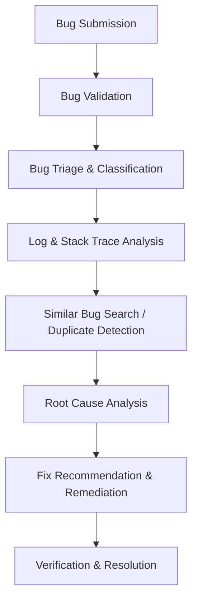
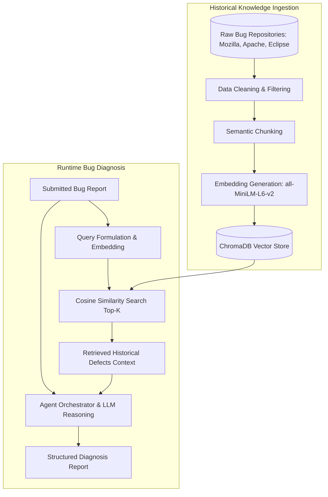

# Software Defect Analysis & RAG Research

## 1. Software Defect Analysis Workflow

Software defect analysis is a systematic engineering discipline designed to identify, understand, isolate, and resolve issues within a software system. In modern production environments, defect lifecycles follow a structured multi-phase workflow:

### A. Bug Submission
- **Description**: Developers or automated crash-reporting systems submit an issue with contextual details, including title, observed behavior, reproduction steps, execution environment, configuration details, and attached error logs or stack traces.
- **Challenges**: Incomplete descriptions, noisy or malformed stack traces, missing environment specifications, and duplicate submissions.

### B. Bug Validation
- **Description**: Initial gatekeeping to verify whether the report represents a legitimate bug rather than user error, configuration drift, or duplicate issue.
- **Key Metrics**: Completeness of reproduction data, syntactical validity of error logs, and issue reproducibility.

### C. Bug Classification & Triage
- **Description**: Rapid assessment to determine the defect's **Severity** (impact on the system: Critical, High, Medium, Low), **Priority** (order of resolution), and the **Affected Component** (e.g., Auth, Database, UI, Network).
- **Automation Potential**: Machine learning classifiers and LLMs can infer component mappings and severity based on exception types, crash symptoms, and subsystem keywords.

### D. Log & Stack Trace Analysis
- **Description**: Deep parsing of runtime artifacts to identify:
  1. Primary exception types (e.g., `NullPointerException`, `IndexOutOfBoundsException`, `ConnectionTimeout`).
  2. Failure points (exact file, class, method, and line number).
  3. Execution call-path leading to failure.
- **Significance**: Stack traces pinpoint the exact point of execution termination, but the fundamental root cause often originates several frames earlier in data validation or state initialization.

### E. Similar Bug Search & Duplicate Detection
- **Description**: Searching historical defect databases (e.g., Bugzilla, Jira, GitHub Issues) to identify existing occurrences of the defect.
- **Value**: Prevents duplicate developer effort and provides immediate access to previously validated workarounds and patches.

### F. Root Cause Analysis (RCA)
- **Description**: Differentiating the superficial symptom (e.g., null pointer) from the underlying flaw (e.g., missing null-check during user session deserialization).
- **RAG Enhancement**: Historical defects provide precedent, revealing how similar failure modes in the same or related architectures were previously diagnosed.

### G. Fix Recommendation & Remediation
- **Description**: Proposing precise corrective actions, including code modifications, configuration tuning, boundary checks, and architectural patterns.
- **Evidence Distinction**: Remediation must separate empirically verified historical fixes from heuristic best practices.

### H. Verification & Resolution
- **Description**: Validating the fix against unit, regression, and integration tests, updating defect status, and committing the verified resolution back into the defect knowledge base.

---

## 2. RAG (Retrieval-Augmented Generation) Architecture for Defect Diagnosis

Retrieval-Augmented Generation bridges static language model reasoning with dynamic, specialized historical repositories. Standard LLMs lack awareness of specific institutional bugs, open-source repository quirks, or recent regression patterns. RAG supplies relevant context directly into the prompt.

### Detailed Pipeline Stages:
1. **Document Collection**: Ingestion of verified defect databases (Mozilla Bugzilla, Apache JIRA, Eclipse Bugzilla).
2. **Data Cleaning**: Stripping HTML, normalization of stack traces, removal of duplicate/empty records, and mapping inconsistent schemas to a unified representation.
3. **Chunking**: Dividing documents into cohesive units (descriptions, stack traces, comments, resolution commits) to preserve semantic locality.
4. **Embedding Generation**: Converting text into dense semantic vector embeddings.
5. **Vector Storage**: Persisting embeddings and structured metadata in an indexed vector database (ChromaDB).
6. **Query Embedding**: Transforming incoming user bug reports into the shared vector space using the exact same embedding model.
7. **Similarity Search**: Performing approximate nearest neighbors (ANN) or exact cosine distance search.
8. **Context Retrieval**: Extracting top-K historical defect chunks and their metadata (bug IDs, components, resolutions).
9. **LLM Reasoning**: Augmenting the prompt with user symptoms and historical precedent for grounded diagnostic inference.
10. **Structured Response**: Formatting outputs into standardized JSON schemas containing confidence ratings and evidence citations.

---

## 3. Semantic Similarity & Vector Mathematics

Keyword-based search (e.g., BM25, TF-IDF) fails when bug reports describe identical defects using different vocabulary (e.g., *"App crashes on sign-in"* vs. *"NullPointerException during authentication sequence"*). Semantic similarity overcomes this lexical mismatch.

### A. Dense Embeddings
An embedding model maps textual strings $T$ to a high-dimensional continuous vector space $\mathbb{R}^d$:
$$f: T \to \mathbf{v} \in \mathbb{R}^d$$
In our platform, `all-MiniLM-L6-v2` produces dense vectors of dimension $d = 384$. Tokens that appear in similar semantic contexts gravitate toward proximate vector coordinates.

### B. Cosine Similarity
Given a query vector $\mathbf{q}$ (representing the submitted bug) and a document vector $\mathbf{d}$ (representing a historical defect chunk), cosine similarity measures the cosine of the angle between them:
$$\text{Cosine Similarity}(\mathbf{q}, \mathbf{d}) = \frac{\mathbf{q} \cdot \mathbf{d}}{\|\mathbf{q}\| \|\mathbf{d}\|} = \frac{\sum_{i=1}^{d} q_i d_i}{\sqrt{\sum_{i=1}^d q_i^2} \sqrt{\sum_{i=1}^d d_i^2}}$$
- Value ranges from $-1.0$ (opposite) to $1.0$ (identical direction).
- For normalized vectors ($\|\mathbf{q}\| = \|\mathbf{d}\| = 1$), cosine similarity simplifies directly to the inner dot product: $\mathbf{q} \cdot \mathbf{d}$.

### C. Similarity Thresholds for Duplicate & Related Defect Detection
To eliminate arbitrary categorization, our duplicate detection agent adheres to calibrated empirical thresholds:
| Similarity Range | Classification | Actionable Meaning |
| :--- | :--- | :--- |
| **$S \ge 0.85$** | **Likely Duplicate** | High probability of being the identical underlying defect; historical fix directly applicable. |
| **$0.65 \le S < 0.85$** | **Related Issue** | Shared component, failure mode, or exception pattern; useful for reference. |
| **$S < 0.65$** | **New / Unmatched** | Novel defect without close historical match in the vector space. |
| **Insufficient Text** | **Insufficient Evidence** | Missing description or trace prevents reliable semantic comparison. |

---

## 4. Standardized Bug Report Structure

A robust defect schema requires capturing operational metadata alongside runtime diagnostics:
- **`bug_id`**: Globally unique identifier (UUIDv4).
- **`user_id`**: Submitting developer identifier for auditability and access control.
- **`title`**: Concise summary of failure symptoms.
- **`description`**: Detailed reproduction steps, observed vs. expected behavior.
- **`stack_trace`**: Full runtime call stack including thread status, exception chain, and file coordinates.
- **`error_logs`**: Surrounding operational or container logs prior to crash.
- **`component`**: System boundary or architectural module (e.g., Auth, Storage, Billing).
- **`environment`**: OS, runtime version, browser, container environment.
- **`severity`**: System impact level (`Critical`, `High`, `Medium`, `Low`).
- **`priority`**: Resolution urgency (`Critical`, `High`, `Medium`, `Low`).
- **`status`**: Lifecycle state (`Submitted`, `Analyzing`, `Diagnosed`, `Closed`).
- **`created_at`**: ISO 8601 UTC timestamp.

---

## 5. Technology Choices & Justification

| Technology | Selection | Rationale & Justification |
| :--- | :--- | :--- |
| **Frontend Framework** | **React + Vite** | High performance, instant HMR, modular component structure, developer-friendly ecosystem. |
| **Styling** | **Tailwind CSS** | Clean developer utility styling without AI bloat, supports responsive professional layouts. |
| **Backend API** | **FastAPI (Python 3.10+)** | Asynchronous execution, automatic OpenAPI/Swagger generation, native Pydantic validation. |
| **Database** | **SQLite (SQLAlchemy)** | Zero-configuration, file-based ACID persistence, ideal for local and student environments. |
| **Vector Database** | **ChromaDB (Persistent)** | Free, open-source, local-first vector store with zero cloud dependencies; fast cosine search. |
| **Embedding Model** | **`all-MiniLM-L6-v2`** | 384-dimensional dense embeddings; high semantic accuracy with low CPU and memory footprint. |
| **Authentication** | **JWT + Passlib (Bcrypt)** | Stateless secure authentication, salted password hashing, decoupled frontend-backend auth. |
| **Testing** | **Pytest** | Standard Python testing framework for unit, integration, and agent validation. |
